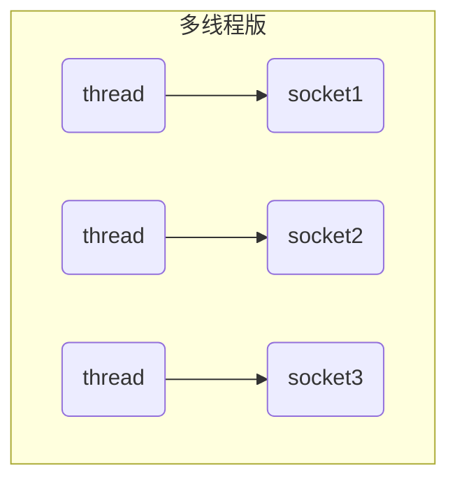
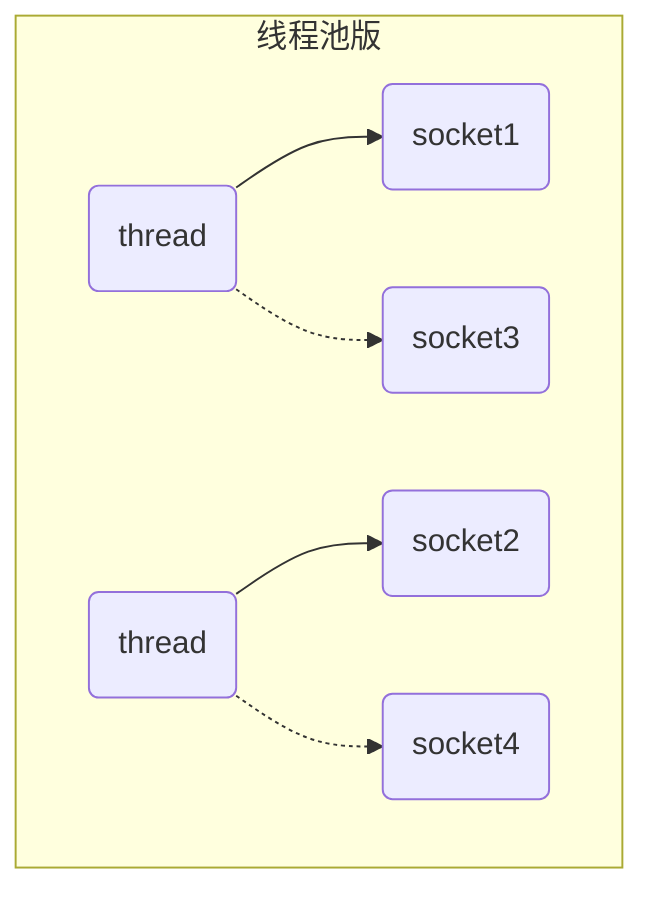
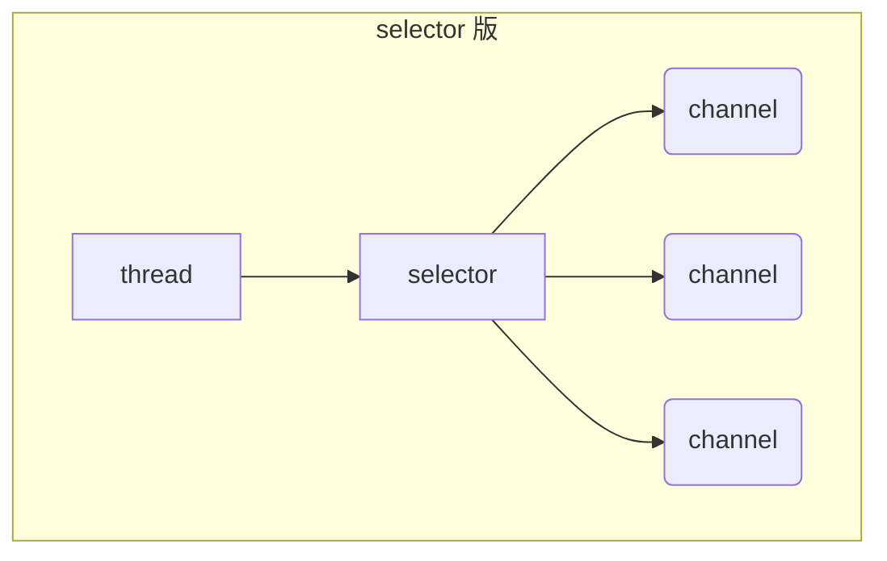
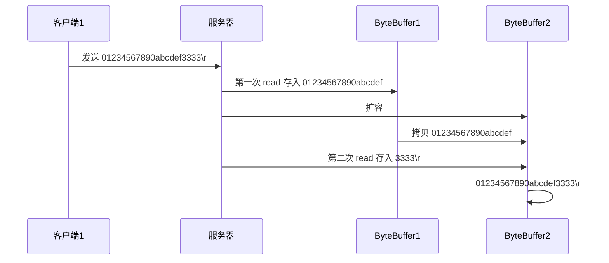

# Netty01-nio

## 一. NIO 基础

non-blocking io 非阻塞 IO

### 1. 三大组件

#### 1.1 Channel & Buffer

channel 有一点类似于 stream，它就是读写数据的**双向通道 双向操作**，可以从 channel 将数据读入 buffer，也可以将 buffer 的数据写入 channel，而之前的 stream 要么是输入，要么是输出**单向操作**，channel 比 stream 更为底层

[5.1 stream vs channel](#JDbd7)


常见的 Channel 有

- FileChannel

- DatagramChannel

- SocketChannel

- ServerSocketChannel

buffer 则用来缓冲读写数据，常见的 buffer 有

- ByteBuffer

- MappedByteBuffer

- DirectByteBuffer

- HeapByteBuffer

- ShortBuffer

- IntBuffer

- LongBuffer

- FloatBuffer

- DoubleBuffer

- CharBuffer

#### 1.2 Selector

selector 单从字面意思不好理解，需要结合服务器的设计演化来理解它的用途

##### 多线程版设计



##### ⚠️多线程版缺点

- 内存占用高

- 线程上下文切换成本高

- 只适合连接数少的场景

> 没来一个socket连接就会分配一个线程去处理，导致内存占用高，线程多了上下文切换成本也高。

Socket 更像是那个**码头**或**船坞**，它负责管理和协调小船（数据报）的进出

##### 线程池版设计



##### ⚠️线程池版缺点

- 阻塞模式下，线程仅能处理一个 socket 连接

- 仅适合短连接场景

> 线程池共2个线程，处理四个socket，在socket1未断开连接之前，thread1只能服务socket1，如果socket1什么请求也不发送，就保持连接，thread1也不得不被阻塞在哪。因此造成线程利用率低的问题。仅适用于http这样的短链接，发送完请求后，就断开连接。

##### selector 版设计

selector 的作用就是配合一个线程来管理多个 channel，获取这些 channel 上发生的事件，这些 channel 工作在非阻塞模式下，不会让线程吊死在一个 channel 上。适合连接数特别多，但流量低的场景（low traffic）



调用 selector 的 select() 会阻塞直到 channel 发生了读写就绪事件，这些事件发生，select 方法就会返回这些事件交给 thread 来处理

> 使用selector进行监听所有的链接，可以是channel可以是socket。当有channel发送请求过来时，就分配线程去处理它，处理完后，thread不会被阻塞在那个channel连接上，因为select()方法会阻塞 channel , 因此 thread 是非阻塞的。但如果一个channel不断发送请求过去，被分配的thread也会被一直占用，因此适用于流量低的场景，但我认为整一个线程池配合selector就可以解决。

### 2. ByteBuffer

有一普通文本文件 data.txt，内容为

```plain
1234567890abcd
```

使用 FileChannel 来读取文件内容

```java
public void test(){
      /*
      * 定义FileChannel
      * 1. 输入输出流 2. RandomAccessFile
      */
        try (FileChannel channel = new FileInputStream("data.txt").getChannel()) {
            //准备缓冲区
            ByteBuffer buf = ByteBuffer.allocate(10);
            while(true){
                //记住channel是通道，有两个口，我们始终站在程序角度，当其他地方传输数据到channel中时，我们调用channel.read读取数据，并读入到程序中。channel.write就是写出数据到channel中从另一个口出。
                //站在程序角度，是写出，读入
                //和文件IO并没有不同，都是创建程序缓存区，然后 inputStream.read(程序缓冲区) outputStream.write(程序缓冲区) 而 channel 既有 read 也有 write 
                int len = channel.read(buf);
                log.debug("读取到的字节数：{}", len);
                if("-1".equals(len + "")){
                    break;
                }
                /*
                ByteBuffer有两种主要状态：写入模式和读取模式。
                buf.flip()方法的作用是将ByteBuffer从写入模式转换为读取模式。
                 */
                buf.flip();
                while(buf.hasRemaining()){
                    /*
                    从buf缓冲区中读出，之后在写入，会被覆盖掉
                     */
                    byte b = buf.get();
                    log.debug("实际字节：{}", (char)b);
                }
                //不是清空缓冲区
                /*
                buf.clear()方法用于将ByteBuffer的状态重置为它可以再次被用来写入数据的状态。
                 */
                buf.clear();
            }
        } catch (IOException e) {
        }
    }
```

输出

```plain
12:02:26.697 [main] DEBUG com.ztyoper.TestFileChannel - 读取到的字节数：10
12:02:26.700 [main] DEBUG com.ztyoper.TestFileChannel - 实际字节：1
12:02:26.700 [main] DEBUG com.ztyoper.TestFileChannel - 实际字节：2
12:02:26.700 [main] DEBUG com.ztyoper.TestFileChannel - 实际字节：3
12:02:26.700 [main] DEBUG com.ztyoper.TestFileChannel - 实际字节：4
12:02:26.700 [main] DEBUG com.ztyoper.TestFileChannel - 实际字节：5
12:02:26.701 [main] DEBUG com.ztyoper.TestFileChannel - 实际字节：6
12:02:26.701 [main] DEBUG com.ztyoper.TestFileChannel - 实际字节：7
12:02:26.701 [main] DEBUG com.ztyoper.TestFileChannel - 实际字节：8
12:02:26.701 [main] DEBUG com.ztyoper.TestFileChannel - 实际字节：9
12:02:26.701 [main] DEBUG com.ztyoper.TestFileChannel - 实际字节：0
12:02:26.701 [main] DEBUG com.ztyoper.TestFileChannel - 读取到的字节数：3
12:02:26.701 [main] DEBUG com.ztyoper.TestFileChannel - 实际字节：a
12:02:26.701 [main] DEBUG com.ztyoper.TestFileChannel - 实际字节：b
12:02:26.701 [main] DEBUG com.ztyoper.TestFileChannel - 实际字节：c
12:02:26.701 [main] DEBUG com.ztyoper.TestFileChannel - 读取到的字节数：-1
```

或者

```java
@Slf4j
public class ChannelDemo1 {
    public static void main(String[] args) {
        try (RandomAccessFile file = new RandomAccessFile("helloword/data.txt", "rw")) {
            FileChannel channel = file.getChannel();
            ByteBuffer buffer = ByteBuffer.allocate(10);
            do {
                // 向 buffer 写入
                int len = channel.read(buffer);
                log.debug("读到字节数：{}", len);
                if (len == -1) {
                    break;
                }
                // 切换 buffer 读模式
                buffer.flip();
                while(buffer.hasRemaining()) {
                    log.debug("{}", (char)buffer.get());
                }
                // 切换 buffer 写模式
                buffer.clear();
            } while (true);
        } catch (IOException e) {
            e.printStackTrace();
        }
    }
}
```

输出

```plain
10:39:03 [DEBUG] [main] c.i.n.ChannelDemo1 - 读到字节数：10
10:39:03 [DEBUG] [main] c.i.n.ChannelDemo1 - 1
10:39:03 [DEBUG] [main] c.i.n.ChannelDemo1 - 2
10:39:03 [DEBUG] [main] c.i.n.ChannelDemo1 - 3
10:39:03 [DEBUG] [main] c.i.n.ChannelDemo1 - 4
10:39:03 [DEBUG] [main] c.i.n.ChannelDemo1 - 5
10:39:03 [DEBUG] [main] c.i.n.ChannelDemo1 - 6
10:39:03 [DEBUG] [main] c.i.n.ChannelDemo1 - 7
10:39:03 [DEBUG] [main] c.i.n.ChannelDemo1 - 8
10:39:03 [DEBUG] [main] c.i.n.ChannelDemo1 - 9
10:39:03 [DEBUG] [main] c.i.n.ChannelDemo1 - 0
10:39:03 [DEBUG] [main] c.i.n.ChannelDemo1 - 读到字节数：4
10:39:03 [DEBUG] [main] c.i.n.ChannelDemo1 - a
10:39:03 [DEBUG] [main] c.i.n.ChannelDemo1 - b
10:39:03 [DEBUG] [main] c.i.n.ChannelDemo1 - c
10:39:03 [DEBUG] [main] c.i.n.ChannelDemo1 - d
10:39:03 [DEBUG] [main] c.i.n.ChannelDemo1 - 读到字节数：-1
```

#### 2.1 ByteBuffer 正确使用姿势

1. 向 buffer 写入数据，例如调用 channel.read(buffer)

2. 调用 flip() 切换至 **读模式**

3. 从 buffer 读取数据，例如调用 buffer.get()

4. 调用 clear() 或 compact() 切换至 **写模式**

5. 重复 1~4 步骤

#### 2.2 ByteBuffer 结构

ByteBuffer 有以下重要属性

- capacity

- position

- limit

一开始


写模式下，position 是写入位置，limit 等于容量，下图表示写入了 4 个字节后的状态


flip 动作发生后，position 切换为读取位置，limit 切换为读取限制


读取 4 个字节后，状态


clear 动作发生后，状态


compact 方法，是把未读完的部分向前压缩，然后切换至写模式


##### 💡调试工具类

```java
public class ByteBufferUtil {
    private static final char[] BYTE2CHAR = new char[256];
    private static final char[] HEXDUMP_TABLE = new char[256 * 4];
    private static final String[] HEXPADDING = new String[16];
    private static final String[] HEXDUMP_ROWPREFIXES = new String[65536 >>> 4];
    private static final String[] BYTE2HEX = new String[256];
    private static final String[] BYTEPADDING = new String[16];

    static {
        final char[] DIGITS = "0123456789abcdef".toCharArray();
        for (int i = 0; i < 256; i++) {
            HEXDUMP_TABLE[i << 1] = DIGITS[i >>> 4 & 0x0F];
            HEXDUMP_TABLE[(i << 1) + 1] = DIGITS[i & 0x0F];
        }

        int i;

        // Generate the lookup table for hex dump paddings
        for (i = 0; i < HEXPADDING.length; i++) {
            int padding = HEXPADDING.length - i;
            StringBuilder buf = new StringBuilder(padding * 3);
            for (int j = 0; j < padding; j++) {
                buf.append("   ");
            }
            HEXPADDING[i] = buf.toString();
        }

        // Generate the lookup table for the start-offset header in each row (up to 64KiB).
        for (i = 0; i < HEXDUMP_ROWPREFIXES.length; i++) {
            StringBuilder buf = new StringBuilder(12);
            buf.append(NEWLINE);
            buf.append(Long.toHexString(i << 4 & 0xFFFFFFFFL | 0x100000000L));
            buf.setCharAt(buf.length() - 9, '|');
            buf.append('|');
            HEXDUMP_ROWPREFIXES[i] = buf.toString();
        }

        // Generate the lookup table for byte-to-hex-dump conversion
        for (i = 0; i < BYTE2HEX.length; i++) {
            BYTE2HEX[i] = ' ' + StringUtil.byteToHexStringPadded(i);
        }

        // Generate the lookup table for byte dump paddings
        for (i = 0; i < BYTEPADDING.length; i++) {
            int padding = BYTEPADDING.length - i;
            StringBuilder buf = new StringBuilder(padding);
            for (int j = 0; j < padding; j++) {
                buf.append(' ');
            }
            BYTEPADDING[i] = buf.toString();
        }

        // Generate the lookup table for byte-to-char conversion
        for (i = 0; i < BYTE2CHAR.length; i++) {
            if (i <= 0x1f || i >= 0x7f) {
                BYTE2CHAR[i] = '.';
            } else {
                BYTE2CHAR[i] = (char) i;
            }
        }
    }

    /**
     * 打印所有内容
     * @param buffer
     */
    public static void debugAll(ByteBuffer buffer) {
        int oldlimit = buffer.limit();
        buffer.limit(buffer.capacity());
        StringBuilder origin = new StringBuilder(256);
        appendPrettyHexDump(origin, buffer, 0, buffer.capacity());
        System.out.println("+--------+-------------------- all ------------------------+----------------+");
        System.out.printf("position: [%d], limit: [%d]\n", buffer.position(), oldlimit);
        System.out.println(origin);
        buffer.limit(oldlimit);
    }

    /**
     * 打印可读取内容
     * @param buffer
     */
    public static void debugRead(ByteBuffer buffer) {
        StringBuilder builder = new StringBuilder(256);
        appendPrettyHexDump(builder, buffer, buffer.position(), buffer.limit() - buffer.position());
        System.out.println("+--------+-------------------- read -----------------------+----------------+");
        System.out.printf("position: [%d], limit: [%d]\n", buffer.position(), buffer.limit());
        System.out.println(builder);
    }

    private static void appendPrettyHexDump(StringBuilder dump, ByteBuffer buf, int offset, int length) {
        if (isOutOfBounds(offset, length, buf.capacity())) {
            throw new IndexOutOfBoundsException(
                    "expected: " + "0 <= offset(" + offset + ") <= offset + length(" + length
                            + ") <= " + "buf.capacity(" + buf.capacity() + ')');
        }
        if (length == 0) {
            return;
        }
        dump.append(
                "         +-------------------------------------------------+" +
                        NEWLINE + "         |  0  1  2  3  4  5  6  7  8  9  a  b  c  d  e  f |" +
                        NEWLINE + "+--------+-------------------------------------------------+----------------+");

        final int startIndex = offset;
        final int fullRows = length >>> 4;
        final int remainder = length & 0xF;

        // Dump the rows which have 16 bytes.
        for (int row = 0; row < fullRows; row++) {
            int rowStartIndex = (row << 4) + startIndex;

            // Per-row prefix.
            appendHexDumpRowPrefix(dump, row, rowStartIndex);

            // Hex dump
            int rowEndIndex = rowStartIndex + 16;
            for (int j = rowStartIndex; j < rowEndIndex; j++) {
                dump.append(BYTE2HEX[getUnsignedByte(buf, j)]);
            }
            dump.append(" |");

            // ASCII dump
            for (int j = rowStartIndex; j < rowEndIndex; j++) {
                dump.append(BYTE2CHAR[getUnsignedByte(buf, j)]);
            }
            dump.append('|');
        }

        // Dump the last row which has less than 16 bytes.
        if (remainder != 0) {
            int rowStartIndex = (fullRows << 4) + startIndex;
            appendHexDumpRowPrefix(dump, fullRows, rowStartIndex);

            // Hex dump
            int rowEndIndex = rowStartIndex + remainder;
            for (int j = rowStartIndex; j < rowEndIndex; j++) {
                dump.append(BYTE2HEX[getUnsignedByte(buf, j)]);
            }
            dump.append(HEXPADDING[remainder]);
            dump.append(" |");

            // Ascii dump
            for (int j = rowStartIndex; j < rowEndIndex; j++) {
                dump.append(BYTE2CHAR[getUnsignedByte(buf, j)]);
            }
            dump.append(BYTEPADDING[remainder]);
            dump.append('|');
        }

        dump.append(NEWLINE +
                "+--------+-------------------------------------------------+----------------+");
    }

    private static void appendHexDumpRowPrefix(StringBuilder dump, int row, int rowStartIndex) {
        if (row < HEXDUMP_ROWPREFIXES.length) {
            dump.append(HEXDUMP_ROWPREFIXES[row]);
        } else {
            dump.append(NEWLINE);
            dump.append(Long.toHexString(rowStartIndex & 0xFFFFFFFFL | 0x100000000L));
            dump.setCharAt(dump.length() - 9, '|');
            dump.append('|');
        }
    }

    public static short getUnsignedByte(ByteBuffer buffer, int index) {
        return (short) (buffer.get(index) & 0xFF);
    }
}
```

使用ByteBufferUtils进行深入理解上述的几个图

```java
package com.ztyoper;

import java.nio.ByteBuffer;

import static com.ztyoper.ByteBufferUtil.debugAll;

/**
 * @author ztyOperation
 * @ClassName TestByteBuffer
 * @description: TODO
 * @date 2024年07月07日
 * @version: 1.0
 */
public class TestByteBuffer {
    public static void main(String[] args) {
        ByteBuffer buf = ByteBuffer.allocate(10);
        // 字母 'a' 十六进制
        buf.put((byte)0x61);
        debugAll(buf);
        buf.put(new byte[]{0x62 ,0x63 ,0x64});
        debugAll(buf);
        //切换到读取模式
        buf.flip();
        System.out.println(buf.get());
        debugAll(buf);

        buf.compact();
        debugAll(buf);
        buf.put(new byte[]{0x65, 0x66});
        debugAll(buf);
    }
}
```

输出

```plain
D:\develop_tools\jdk1.8.0_271\bin\java.exe "-javaagent:D:\develop_tools\IntelliJ IDEA 2024.1.4\lib\idea_rt.jar=50488:D:\develop_tools\IntelliJ IDEA 2024.1.4\bin" -Dfile.encoding=UTF-8 -classpath D:\develop_tools\jdk1.8.0_271\jre\lib\charsets.jar;D:\develop_tools\jdk1.8.0_271\jre\lib\deploy.jar;D:\develop_tools\jdk1.8.0_271\jre\lib\ext\access-bridge-64.jar;D:\develop_tools\jdk1.8.0_271\jre\lib\ext\cldrdata.jar;D:\develop_tools\jdk1.8.0_271\jre\lib\ext\dnsns.jar;D:\develop_tools\jdk1.8.0_271\jre\lib\ext\jaccess.jar;D:\develop_tools\jdk1.8.0_271\jre\lib\ext\jfxrt.jar;D:\develop_tools\jdk1.8.0_271\jre\lib\ext\localedata.jar;D:\develop_tools\jdk1.8.0_271\jre\lib\ext\nashorn.jar;D:\develop_tools\jdk1.8.0_271\jre\lib\ext\sunec.jar;D:\develop_tools\jdk1.8.0_271\jre\lib\ext\sunjce_provider.jar;D:\develop_tools\jdk1.8.0_271\jre\lib\ext\sunmscapi.jar;D:\develop_tools\jdk1.8.0_271\jre\lib\ext\sunpkcs11.jar;D:\develop_tools\jdk1.8.0_271\jre\lib\ext\zipfs.jar;D:\develop_tools\jdk1.8.0_271\jre\lib\javaws.jar;D:\develop_tools\jdk1.8.0_271\jre\lib\jce.jar;D:\develop_tools\jdk1.8.0_271\jre\lib\jfr.jar;D:\develop_tools\jdk1.8.0_271\jre\lib\jfxswt.jar;D:\develop_tools\jdk1.8.0_271\jre\lib\jsse.jar;D:\develop_tools\jdk1.8.0_271\jre\lib\management-agent.jar;D:\develop_tools\jdk1.8.0_271\jre\lib\plugin.jar;D:\develop_tools\jdk1.8.0_271\jre\lib\resources.jar;D:\develop_tools\jdk1.8.0_271\jre\lib\rt.jar;D:\workspace\workspace_idea3\netty-demo\target\classes;D:\develop_tools\apache-maven-3.8.7\maven-repo\io\netty\netty-all\4.1.73.Final\netty-all-4.1.73.Final.jar;D:\develop_tools\apache-maven-3.8.7\maven-repo\io\netty\netty-buffer\4.1.73.Final\netty-buffer-4.1.73.Final.jar;D:\develop_tools\apache-maven-3.8.7\maven-repo\io\netty\netty-codec\4.1.73.Final\netty-codec-4.1.73.Final.jar;D:\develop_tools\apache-maven-3.8.7\maven-repo\io\netty\netty-codec-dns\4.1.73.Final\netty-codec-dns-4.1.73.Final.jar;D:\develop_tools\apache-maven-3.8.7\maven-repo\io\netty\netty-codec-haproxy\4.1.73.Final\netty-codec-haproxy-4.1.73.Final.jar;D:\develop_tools\apache-maven-3.8.7\maven-repo\io\netty\netty-codec-http\4.1.73.Final\netty-codec-http-4.1.73.Final.jar;D:\develop_tools\apache-maven-3.8.7\maven-repo\io\netty\netty-codec-http2\4.1.73.Final\netty-codec-http2-4.1.73.Final.jar;D:\develop_tools\apache-maven-3.8.7\maven-repo\io\netty\netty-codec-memcache\4.1.73.Final\netty-codec-memcache-4.1.73.Final.jar;D:\develop_tools\apache-maven-3.8.7\maven-repo\io\netty\netty-codec-mqtt\4.1.73.Final\netty-codec-mqtt-4.1.73.Final.jar;D:\develop_tools\apache-maven-3.8.7\maven-repo\io\netty\netty-codec-redis\4.1.73.Final\netty-codec-redis-4.1.73.Final.jar;D:\develop_tools\apache-maven-3.8.7\maven-repo\io\netty\netty-codec-smtp\4.1.73.Final\netty-codec-smtp-4.1.73.Final.jar;D:\develop_tools\apache-maven-3.8.7\maven-repo\io\netty\netty-codec-socks\4.1.73.Final\netty-codec-socks-4.1.73.Final.jar;D:\develop_tools\apache-maven-3.8.7\maven-repo\io\netty\netty-codec-stomp\4.1.73.Final\netty-codec-stomp-4.1.73.Final.jar;D:\develop_tools\apache-maven-3.8.7\maven-repo\io\netty\netty-codec-xml\4.1.73.Final\netty-codec-xml-4.1.73.Final.jar;D:\develop_tools\apache-maven-3.8.7\maven-repo\io\netty\netty-common\4.1.73.Final\netty-common-4.1.73.Final.jar;D:\develop_tools\apache-maven-3.8.7\maven-repo\io\netty\netty-handler\4.1.73.Final\netty-handler-4.1.73.Final.jar;D:\develop_tools\apache-maven-3.8.7\maven-repo\io\netty\netty-tcnative-classes\2.0.46.Final\netty-tcnative-classes-2.0.46.Final.jar;D:\develop_tools\apache-maven-3.8.7\maven-repo\io\netty\netty-handler-proxy\4.1.73.Final\netty-handler-proxy-4.1.73.Final.jar;D:\develop_tools\apache-maven-3.8.7\maven-repo\io\netty\netty-resolver\4.1.73.Final\netty-resolver-4.1.73.Final.jar;D:\develop_tools\apache-maven-3.8.7\maven-repo\io\netty\netty-resolver-dns\4.1.73.Final\netty-resolver-dns-4.1.73.Final.jar;D:\develop_tools\apache-maven-3.8.7\maven-repo\io\netty\netty-transport\4.1.73.Final\netty-transport-4.1.73.Final.jar;D:\develop_tools\apache-maven-3.8.7\maven-repo\io\netty\netty-transport-rxtx\4.1.73.Final\netty-transport-rxtx-4.1.73.Final.jar;D:\develop_tools\apache-maven-3.8.7\maven-repo\io\netty\netty-transport-sctp\4.1.73.Final\netty-transport-sctp-4.1.73.Final.jar;D:\develop_tools\apache-maven-3.8.7\maven-repo\io\netty\netty-transport-udt\4.1.73.Final\netty-transport-udt-4.1.73.Final.jar;D:\develop_tools\apache-maven-3.8.7\maven-repo\io\netty\netty-transport-classes-epoll\4.1.73.Final\netty-transport-classes-epoll-4.1.73.Final.jar;D:\develop_tools\apache-maven-3.8.7\maven-repo\io\netty\netty-transport-native-unix-common\4.1.73.Final\netty-transport-native-unix-common-4.1.73.Final.jar;D:\develop_tools\apache-maven-3.8.7\maven-repo\io\netty\netty-transport-classes-kqueue\4.1.73.Final\netty-transport-classes-kqueue-4.1.73.Final.jar;D:\develop_tools\apache-maven-3.8.7\maven-repo\io\netty\netty-resolver-dns-classes-macos\4.1.73.Final\netty-resolver-dns-classes-macos-4.1.73.Final.jar;D:\develop_tools\apache-maven-3.8.7\maven-repo\io\netty\netty-transport-native-epoll\4.1.73.Final\netty-transport-native-epoll-4.1.73.Final-linux-x86_64.jar;D:\develop_tools\apache-maven-3.8.7\maven-repo\io\netty\netty-transport-native-epoll\4.1.73.Final\netty-transport-native-epoll-4.1.73.Final-linux-aarch_64.jar;D:\develop_tools\apache-maven-3.8.7\maven-repo\io\netty\netty-transport-native-kqueue\4.1.73.Final\netty-transport-native-kqueue-4.1.73.Final-osx-x86_64.jar;D:\develop_tools\apache-maven-3.8.7\maven-repo\io\netty\netty-transport-native-kqueue\4.1.73.Final\netty-transport-native-kqueue-4.1.73.Final-osx-aarch_64.jar;D:\develop_tools\apache-maven-3.8.7\maven-repo\io\netty\netty-resolver-dns-native-macos\4.1.73.Final\netty-resolver-dns-native-macos-4.1.73.Final-osx-x86_64.jar;D:\develop_tools\apache-maven-3.8.7\maven-repo\io\netty\netty-resolver-dns-native-macos\4.1.73.Final\netty-resolver-dns-native-macos-4.1.73.Final-osx-aarch_64.jar;D:\develop_tools\apache-maven-3.8.7\maven-repo\org\projectlombok\lombok\1.18.30\lombok-1.18.30.jar;D:\develop_tools\apache-maven-3.8.7\maven-repo\com\google\code\gson\gson\2.10.1\gson-2.10.1.jar;D:\develop_tools\apache-maven-3.8.7\maven-repo\com\google\guava\guava\32.0.0-android\guava-32.0.0-android.jar;D:\develop_tools\apache-maven-3.8.7\maven-repo\com\google\guava\failureaccess\1.0.1\failureaccess-1.0.1.jar;D:\develop_tools\apache-maven-3.8.7\maven-repo\com\google\guava\listenablefuture\9999.0-empty-to-avoid-conflict-with-guava\listenablefuture-9999.0-empty-to-avoid-conflict-with-guava.jar;D:\develop_tools\apache-maven-3.8.7\maven-repo\com\google\code\findbugs\jsr305\3.0.2\jsr305-3.0.2.jar;D:\develop_tools\apache-maven-3.8.7\maven-repo\org\checkerframework\checker-qual\3.33.0\checker-qual-3.33.0.jar;D:\develop_tools\apache-maven-3.8.7\maven-repo\com\google\errorprone\error_prone_annotations\2.18.0\error_prone_annotations-2.18.0.jar;D:\develop_tools\apache-maven-3.8.7\maven-repo\com\google\j2objc\j2objc-annotations\2.8\j2objc-annotations-2.8.jar;D:\develop_tools\apache-maven-3.8.7\maven-repo\ch\qos\logback\logback-classic\1.2.12\logback-classic-1.2.12.jar;D:\develop_tools\apache-maven-3.8.7\maven-repo\ch\qos\logback\logback-core\1.2.12\logback-core-1.2.12.jar;D:\develop_tools\apache-maven-3.8.7\maven-repo\org\slf4j\slf4j-api\1.7.32\slf4j-api-1.7.32.jar;D:\develop_tools\apache-maven-3.8.7\maven-repo\junit\junit\4.13.1\junit-4.13.1.jar;D:\develop_tools\apache-maven-3.8.7\maven-repo\org\hamcrest\hamcrest-core\1.3\hamcrest-core-1.3.jar com.ztyoper.TestByteBuffer
12:45:30.372 [main] DEBUG io.netty.util.internal.logging.InternalLoggerFactory - Using SLF4J as the default logging framework
+--------+-------------------- all ------------------------+----------------+
position: [1], limit: [10]
//当前position指针到1的位置，下次写入就是写入到position的位置
         +-------------------------------------------------+
         |  0  1  2  3  4  5  6  7  8  9  a  b  c  d  e  f |
+--------+-------------------------------------------------+----------------+
|00000000| 61 00 00 00 00 00 00 00 00 00                   |a.........      |
+--------+-------------------------------------------------+----------------+
+--------+-------------------- all ------------------------+----------------+
position: [4], limit: [10]
         +-------------------------------------------------+
         |  0  1  2  3  4  5  6  7  8  9  a  b  c  d  e  f |
+--------+-------------------------------------------------+----------------+
|00000000| 61 62 63 64 00 00 00 00 00 00                   |abcd......      |
+--------+-------------------------------------------------+----------------+
97
+--------+-------------------- all ------------------------+----------------+
position: [1], limit: [4]
当limit与position相等时，退出hasRemaining返回false
         +-------------------------------------------------+
         |  0  1  2  3  4  5  6  7  8  9  a  b  c  d  e  f |
+--------+-------------------------------------------------+----------------+
|00000000| 61 62 63 64 00 00 00 00 00 00                   |abcd......      |
+--------+-------------------------------------------------+----------------+
+--------+-------------------- all ------------------------+----------------+
position: [3], limit: [10]
         +-------------------------------------------------+
         |  0  1  2  3  4  5  6  7  8  9  a  b  c  d  e  f |
+--------+-------------------------------------------------+----------------+
|00000000| 62 63 64 64 00 00 00 00 00 00                   |bcdd......      |
+--------+-------------------------------------------------+----------------+
+--------+-------------------- all ------------------------+----------------+
position: [5], limit: [10]
         +-------------------------------------------------+
         |  0  1  2  3  4  5  6  7  8  9  a  b  c  d  e  f |
+--------+-------------------------------------------------+----------------+
|00000000| 62 63 64 65 66 00 00 00 00 00                   |bcdef.....      |
+--------+-------------------------------------------------+----------------+

Process finished with exit code 0
```

#### 2.3 ByteBuffer 常见方法

##### 分配空间

可以使用 allocate 方法为 ByteBuffer 分配空间，其它 buffer 类也有该方法

```java
Bytebuffer buf = ByteBuffer.allocate(16);
```

##### 向 buffer 写入数据

有两种办法

- 调用 channel 的 read 方法

- 调用 buffer 自己的 put 方法

```java
int readBytes = channel.read(buf);
```

和

```java
buf.put((byte)127);
```

##### 从 buffer 读取数据

同样有两种办法

- 调用 channel 的 write 方法

- 调用 buffer 自己的 get 方法

```java
int writeBytes = channel.write(buf);
```

和

```java
byte b = buf.get();
```

get 方法会让 position 读指针向后走，如果想重复读取数据

- 可以调用 rewind 方法将 position 重新置为 0

- 或者调用 get(int i) 方法获取索引 i 的内容，它不会移动读指针

##### mark 和 reset

mark 是在读取时，做一个标记，即使 position 改变，只要调用 reset 就能回到 mark 的位置

> **注意**
> rewind 和 flip 都会清除 mark 位置

```java
package com.ztyoper;

import org.junit.Test;

import java.nio.ByteBuffer;

import static com.ztyoper.ByteBufferUtil.debugAll;

/**
 * @author ztyOperation
 * @ClassName TestMethod
 * @description: TODO
 * @date 2024年07月07日
 * @version: 1.0
 */
public class TestMethod {
    public static void main(String[] args) {
        ByteBuffer buf = ByteBuffer.allocate(10);
        buf.put(new byte[]{'a','b','c','d'});
        buf.flip();
        debugAll(buf);

        //rewind 从头读
        /*buf.get(new byte[4]);
        debugAll(buf);
        buf.rewind();
        System.out.println(buf.get());*/

        //mark & reset

        System.out.println((char) buf.get());
        System.out.println((char) buf.get());
        //加标记， position索引2的位置
        buf.mark();
        System.out.println((char) buf.get());
        System.out.println((char) buf.get());
        //将position重置到索引2
        buf.reset();
        System.out.println((char) buf.get());
        System.out.println((char) buf.get());

    }
}
```

输出

```plain
D:\develop_tools\jdk1.8.0_271\bin\java.exe "-javaagent:D:\develop_tools\IntelliJ IDEA 2024.1.4\lib\idea_rt.jar=51210:D:\develop_tools\IntelliJ IDEA 2024.1.4\bin" -Dfile.encoding=UTF-8 -classpath D:\develop_tools\jdk1.8.0_271\jre\lib\charsets.jar;D:\develop_tools\jdk1.8.0_271\jre\lib\deploy.jar;D:\develop_tools\jdk1.8.0_271\jre\lib\ext\access-bridge-64.jar;D:\develop_tools\jdk1.8.0_271\jre\lib\ext\cldrdata.jar;D:\develop_tools\jdk1.8.0_271\jre\lib\ext\dnsns.jar;D:\develop_tools\jdk1.8.0_271\jre\lib\ext\jaccess.jar;D:\develop_tools\jdk1.8.0_271\jre\lib\ext\jfxrt.jar;D:\develop_tools\jdk1.8.0_271\jre\lib\ext\localedata.jar;D:\develop_tools\jdk1.8.0_271\jre\lib\ext\nashorn.jar;D:\develop_tools\jdk1.8.0_271\jre\lib\ext\sunec.jar;D:\develop_tools\jdk1.8.0_271\jre\lib\ext\sunjce_provider.jar;D:\develop_tools\jdk1.8.0_271\jre\lib\ext\sunmscapi.jar;D:\develop_tools\jdk1.8.0_271\jre\lib\ext\sunpkcs11.jar;D:\develop_tools\jdk1.8.0_271\jre\lib\ext\zipfs.jar;D:\develop_tools\jdk1.8.0_271\jre\lib\javaws.jar;D:\develop_tools\jdk1.8.0_271\jre\lib\jce.jar;D:\develop_tools\jdk1.8.0_271\jre\lib\jfr.jar;D:\develop_tools\jdk1.8.0_271\jre\lib\jfxswt.jar;D:\develop_tools\jdk1.8.0_271\jre\lib\jsse.jar;D:\develop_tools\jdk1.8.0_271\jre\lib\management-agent.jar;D:\develop_tools\jdk1.8.0_271\jre\lib\plugin.jar;D:\develop_tools\jdk1.8.0_271\jre\lib\resources.jar;D:\develop_tools\jdk1.8.0_271\jre\lib\rt.jar;D:\workspace\workspace_idea3\netty-demo\target\classes;D:\develop_tools\apache-maven-3.8.7\maven-repo\io\netty\netty-all\4.1.73.Final\netty-all-4.1.73.Final.jar;D:\develop_tools\apache-maven-3.8.7\maven-repo\io\netty\netty-buffer\4.1.73.Final\netty-buffer-4.1.73.Final.jar;D:\develop_tools\apache-maven-3.8.7\maven-repo\io\netty\netty-codec\4.1.73.Final\netty-codec-4.1.73.Final.jar;D:\develop_tools\apache-maven-3.8.7\maven-repo\io\netty\netty-codec-dns\4.1.73.Final\netty-codec-dns-4.1.73.Final.jar;D:\develop_tools\apache-maven-3.8.7\maven-repo\io\netty\netty-codec-haproxy\4.1.73.Final\netty-codec-haproxy-4.1.73.Final.jar;D:\develop_tools\apache-maven-3.8.7\maven-repo\io\netty\netty-codec-http\4.1.73.Final\netty-codec-http-4.1.73.Final.jar;D:\develop_tools\apache-maven-3.8.7\maven-repo\io\netty\netty-codec-http2\4.1.73.Final\netty-codec-http2-4.1.73.Final.jar;D:\develop_tools\apache-maven-3.8.7\maven-repo\io\netty\netty-codec-memcache\4.1.73.Final\netty-codec-memcache-4.1.73.Final.jar;D:\develop_tools\apache-maven-3.8.7\maven-repo\io\netty\netty-codec-mqtt\4.1.73.Final\netty-codec-mqtt-4.1.73.Final.jar;D:\develop_tools\apache-maven-3.8.7\maven-repo\io\netty\netty-codec-redis\4.1.73.Final\netty-codec-redis-4.1.73.Final.jar;D:\develop_tools\apache-maven-3.8.7\maven-repo\io\netty\netty-codec-smtp\4.1.73.Final\netty-codec-smtp-4.1.73.Final.jar;D:\develop_tools\apache-maven-3.8.7\maven-repo\io\netty\netty-codec-socks\4.1.73.Final\netty-codec-socks-4.1.73.Final.jar;D:\develop_tools\apache-maven-3.8.7\maven-repo\io\netty\netty-codec-stomp\4.1.73.Final\netty-codec-stomp-4.1.73.Final.jar;D:\develop_tools\apache-maven-3.8.7\maven-repo\io\netty\netty-codec-xml\4.1.73.Final\netty-codec-xml-4.1.73.Final.jar;D:\develop_tools\apache-maven-3.8.7\maven-repo\io\netty\netty-common\4.1.73.Final\netty-common-4.1.73.Final.jar;D:\develop_tools\apache-maven-3.8.7\maven-repo\io\netty\netty-handler\4.1.73.Final\netty-handler-4.1.73.Final.jar;D:\develop_tools\apache-maven-3.8.7\maven-repo\io\netty\netty-tcnative-classes\2.0.46.Final\netty-tcnative-classes-2.0.46.Final.jar;D:\develop_tools\apache-maven-3.8.7\maven-repo\io\netty\netty-handler-proxy\4.1.73.Final\netty-handler-proxy-4.1.73.Final.jar;D:\develop_tools\apache-maven-3.8.7\maven-repo\io\netty\netty-resolver\4.1.73.Final\netty-resolver-4.1.73.Final.jar;D:\develop_tools\apache-maven-3.8.7\maven-repo\io\netty\netty-resolver-dns\4.1.73.Final\netty-resolver-dns-4.1.73.Final.jar;D:\develop_tools\apache-maven-3.8.7\maven-repo\io\netty\netty-transport\4.1.73.Final\netty-transport-4.1.73.Final.jar;D:\develop_tools\apache-maven-3.8.7\maven-repo\io\netty\netty-transport-rxtx\4.1.73.Final\netty-transport-rxtx-4.1.73.Final.jar;D:\develop_tools\apache-maven-3.8.7\maven-repo\io\netty\netty-transport-sctp\4.1.73.Final\netty-transport-sctp-4.1.73.Final.jar;D:\develop_tools\apache-maven-3.8.7\maven-repo\io\netty\netty-transport-udt\4.1.73.Final\netty-transport-udt-4.1.73.Final.jar;D:\develop_tools\apache-maven-3.8.7\maven-repo\io\netty\netty-transport-classes-epoll\4.1.73.Final\netty-transport-classes-epoll-4.1.73.Final.jar;D:\develop_tools\apache-maven-3.8.7\maven-repo\io\netty\netty-transport-native-unix-common\4.1.73.Final\netty-transport-native-unix-common-4.1.73.Final.jar;D:\develop_tools\apache-maven-3.8.7\maven-repo\io\netty\netty-transport-classes-kqueue\4.1.73.Final\netty-transport-classes-kqueue-4.1.73.Final.jar;D:\develop_tools\apache-maven-3.8.7\maven-repo\io\netty\netty-resolver-dns-classes-macos\4.1.73.Final\netty-resolver-dns-classes-macos-4.1.73.Final.jar;D:\develop_tools\apache-maven-3.8.7\maven-repo\io\netty\netty-transport-native-epoll\4.1.73.Final\netty-transport-native-epoll-4.1.73.Final-linux-x86_64.jar;D:\develop_tools\apache-maven-3.8.7\maven-repo\io\netty\netty-transport-native-epoll\4.1.73.Final\netty-transport-native-epoll-4.1.73.Final-linux-aarch_64.jar;D:\develop_tools\apache-maven-3.8.7\maven-repo\io\netty\netty-transport-native-kqueue\4.1.73.Final\netty-transport-native-kqueue-4.1.73.Final-osx-x86_64.jar;D:\develop_tools\apache-maven-3.8.7\maven-repo\io\netty\netty-transport-native-kqueue\4.1.73.Final\netty-transport-native-kqueue-4.1.73.Final-osx-aarch_64.jar;D:\develop_tools\apache-maven-3.8.7\maven-repo\io\netty\netty-resolver-dns-native-macos\4.1.73.Final\netty-resolver-dns-native-macos-4.1.73.Final-osx-x86_64.jar;D:\develop_tools\apache-maven-3.8.7\maven-repo\io\netty\netty-resolver-dns-native-macos\4.1.73.Final\netty-resolver-dns-native-macos-4.1.73.Final-osx-aarch_64.jar;D:\develop_tools\apache-maven-3.8.7\maven-repo\org\projectlombok\lombok\1.18.30\lombok-1.18.30.jar;D:\develop_tools\apache-maven-3.8.7\maven-repo\com\google\code\gson\gson\2.10.1\gson-2.10.1.jar;D:\develop_tools\apache-maven-3.8.7\maven-repo\com\google\guava\guava\32.0.0-android\guava-32.0.0-android.jar;D:\develop_tools\apache-maven-3.8.7\maven-repo\com\google\guava\failureaccess\1.0.1\failureaccess-1.0.1.jar;D:\develop_tools\apache-maven-3.8.7\maven-repo\com\google\guava\listenablefuture\9999.0-empty-to-avoid-conflict-with-guava\listenablefuture-9999.0-empty-to-avoid-conflict-with-guava.jar;D:\develop_tools\apache-maven-3.8.7\maven-repo\com\google\code\findbugs\jsr305\3.0.2\jsr305-3.0.2.jar;D:\develop_tools\apache-maven-3.8.7\maven-repo\org\checkerframework\checker-qual\3.33.0\checker-qual-3.33.0.jar;D:\develop_tools\apache-maven-3.8.7\maven-repo\com\google\errorprone\error_prone_annotations\2.18.0\error_prone_annotations-2.18.0.jar;D:\develop_tools\apache-maven-3.8.7\maven-repo\com\google\j2objc\j2objc-annotations\2.8\j2objc-annotations-2.8.jar;D:\develop_tools\apache-maven-3.8.7\maven-repo\ch\qos\logback\logback-classic\1.2.12\logback-classic-1.2.12.jar;D:\develop_tools\apache-maven-3.8.7\maven-repo\ch\qos\logback\logback-core\1.2.12\logback-core-1.2.12.jar;D:\develop_tools\apache-maven-3.8.7\maven-repo\org\slf4j\slf4j-api\1.7.32\slf4j-api-1.7.32.jar;D:\develop_tools\apache-maven-3.8.7\maven-repo\junit\junit\4.13.1\junit-4.13.1.jar;D:\develop_tools\apache-maven-3.8.7\maven-repo\org\hamcrest\hamcrest-core\1.3\hamcrest-core-1.3.jar com.ztyoper.TestMethod
13:01:59.101 [main] DEBUG io.netty.util.internal.logging.InternalLoggerFactory - Using SLF4J as the default logging framework
+--------+-------------------- all ------------------------+----------------+
position: [0], limit: [4]
         +-------------------------------------------------+
         |  0  1  2  3  4  5  6  7  8  9  a  b  c  d  e  f |
+--------+-------------------------------------------------+----------------+
|00000000| 61 62 63 64 00 00 00 00 00 00                   |abcd......      |
+--------+-------------------------------------------------+----------------+
a
b
c
d
c
d

Process finished with exit code 0
```

##### 字符串与 ByteBuffer 互转

```java
package com.ztyoper;

import java.nio.ByteBuffer;
import java.nio.CharBuffer;
import java.nio.charset.Charset;
import java.nio.charset.StandardCharsets;

import static com.ztyoper.ByteBufferUtil.debugAll;

/**
 * @author ztyOperation
 * @ClassName TestEncode
 * @description: TODO
 * @date 2024年07月07日
 * @version: 1.0
 */
public class TestEncode {
    public static void main(String[] args) {

        //1. 字符串转为ByteBuffer , 我们无法动态修改ByteBuffer的大小，Netty优化后可以
            //1.1. HeapByteBuffer
        ByteBuffer buf1 = ByteBuffer.allocate(16);
        buf1.put("你好".getBytes());
        debugAll(buf1);

        //切换到读模式
        buf1.flip();
        String s = StandardCharsets.UTF_8.decode(buf1).toString();
        System.out.println(s);
            //2.2. DirectByteBuffer 这种要快一些
        ByteBuffer buf2 = ByteBuffer.allocateDirect(16);
        buf2.put("你好".getBytes());
        debugAll(buf2);

        //切换到读模式
        buf2.flip();
        s = StandardCharsets.UTF_8.decode(buf2).toString();
        System.out.println(s);

        //2. Charset
        ByteBuffer buffer1 = StandardCharsets.UTF_8.encode("你好");
        ByteBuffer buffer2 = Charset.forName("utf-8").encode("你好");
        debugAll(buffer1);
        //buffer1 ,buffer2已经被切换到读取模式了，也就是调用了flip函数，并且缓冲区分配长度与字节长度一致
        s = StandardCharsets.UTF_8.decode(buffer1).toString();
        System.out.println(s);

        //3. wrap
        ByteBuffer buffer3 = ByteBuffer.wrap("你好".getBytes());
        debugAll(buffer3);
        //buffer3已经被切换到读取模式了，也就是调用了flip函数，并且缓冲区分配长度与字节长度一致
        s = StandardCharsets.UTF_8.decode(buffer3).toString();
        System.out.println(s);

//
//        debugAll(buffer1);
//        debugAll(buffer2);

    }
}
```

输出

```plain
D:\develop_tools\jdk1.8.0_271\bin\java.exe "-javaagent:D:\develop_tools\IntelliJ IDEA 2024.1.4\lib\idea_rt.jar=65049:D:\develop_tools\IntelliJ IDEA 2024.1.4\bin" -Dfile.encoding=UTF-8 -classpath D:\develop_tools\jdk1.8.0_271\jre\lib\charsets.jar;D:\develop_tools\jdk1.8.0_271\jre\lib\deploy.jar;D:\develop_tools\jdk1.8.0_271\jre\lib\ext\access-bridge-64.jar;D:\develop_tools\jdk1.8.0_271\jre\lib\ext\cldrdata.jar;D:\develop_tools\jdk1.8.0_271\jre\lib\ext\dnsns.jar;D:\develop_tools\jdk1.8.0_271\jre\lib\ext\jaccess.jar;D:\develop_tools\jdk1.8.0_271\jre\lib\ext\jfxrt.jar;D:\develop_tools\jdk1.8.0_271\jre\lib\ext\localedata.jar;D:\develop_tools\jdk1.8.0_271\jre\lib\ext\nashorn.jar;D:\develop_tools\jdk1.8.0_271\jre\lib\ext\sunec.jar;D:\develop_tools\jdk1.8.0_271\jre\lib\ext\sunjce_provider.jar;D:\develop_tools\jdk1.8.0_271\jre\lib\ext\sunmscapi.jar;D:\develop_tools\jdk1.8.0_271\jre\lib\ext\sunpkcs11.jar;D:\develop_tools\jdk1.8.0_271\jre\lib\ext\zipfs.jar;D:\develop_tools\jdk1.8.0_271\jre\lib\javaws.jar;D:\develop_tools\jdk1.8.0_271\jre\lib\jce.jar;D:\develop_tools\jdk1.8.0_271\jre\lib\jfr.jar;D:\develop_tools\jdk1.8.0_271\jre\lib\jfxswt.jar;D:\develop_tools\jdk1.8.0_271\jre\lib\jsse.jar;D:\develop_tools\jdk1.8.0_271\jre\lib\management-agent.jar;D:\develop_tools\jdk1.8.0_271\jre\lib\plugin.jar;D:\develop_tools\jdk1.8.0_271\jre\lib\resources.jar;D:\develop_tools\jdk1.8.0_271\jre\lib\rt.jar;D:\workspace\workspace_idea3\netty-demo\target\classes;D:\develop_tools\apache-maven-3.8.7\maven-repo\io\netty\netty-all\4.1.73.Final\netty-all-4.1.73.Final.jar;D:\develop_tools\apache-maven-3.8.7\maven-repo\io\netty\netty-buffer\4.1.73.Final\netty-buffer-4.1.73.Final.jar;D:\develop_tools\apache-maven-3.8.7\maven-repo\io\netty\netty-codec\4.1.73.Final\netty-codec-4.1.73.Final.jar;D:\develop_tools\apache-maven-3.8.7\maven-repo\io\netty\netty-codec-dns\4.1.73.Final\netty-codec-dns-4.1.73.Final.jar;D:\develop_tools\apache-maven-3.8.7\maven-repo\io\netty\netty-codec-haproxy\4.1.73.Final\netty-codec-haproxy-4.1.73.Final.jar;D:\develop_tools\apache-maven-3.8.7\maven-repo\io\netty\netty-codec-http\4.1.73.Final\netty-codec-http-4.1.73.Final.jar;D:\develop_tools\apache-maven-3.8.7\maven-repo\io\netty\netty-codec-http2\4.1.73.Final\netty-codec-http2-4.1.73.Final.jar;D:\develop_tools\apache-maven-3.8.7\maven-repo\io\netty\netty-codec-memcache\4.1.73.Final\netty-codec-memcache-4.1.73.Final.jar;D:\develop_tools\apache-maven-3.8.7\maven-repo\io\netty\netty-codec-mqtt\4.1.73.Final\netty-codec-mqtt-4.1.73.Final.jar;D:\develop_tools\apache-maven-3.8.7\maven-repo\io\netty\netty-codec-redis\4.1.73.Final\netty-codec-redis-4.1.73.Final.jar;D:\develop_tools\apache-maven-3.8.7\maven-repo\io\netty\netty-codec-smtp\4.1.73.Final\netty-codec-smtp-4.1.73.Final.jar;D:\develop_tools\apache-maven-3.8.7\maven-repo\io\netty\netty-codec-socks\4.1.73.Final\netty-codec-socks-4.1.73.Final.jar;D:\develop_tools\apache-maven-3.8.7\maven-repo\io\netty\netty-codec-stomp\4.1.73.Final\netty-codec-stomp-4.1.73.Final.jar;D:\develop_tools\apache-maven-3.8.7\maven-repo\io\netty\netty-codec-xml\4.1.73.Final\netty-codec-xml-4.1.73.Final.jar;D:\develop_tools\apache-maven-3.8.7\maven-repo\io\netty\netty-common\4.1.73.Final\netty-common-4.1.73.Final.jar;D:\develop_tools\apache-maven-3.8.7\maven-repo\io\netty\netty-handler\4.1.73.Final\netty-handler-4.1.73.Final.jar;D:\develop_tools\apache-maven-3.8.7\maven-repo\io\netty\netty-tcnative-classes\2.0.46.Final\netty-tcnative-classes-2.0.46.Final.jar;D:\develop_tools\apache-maven-3.8.7\maven-repo\io\netty\netty-handler-proxy\4.1.73.Final\netty-handler-proxy-4.1.73.Final.jar;D:\develop_tools\apache-maven-3.8.7\maven-repo\io\netty\netty-resolver\4.1.73.Final\netty-resolver-4.1.73.Final.jar;D:\develop_tools\apache-maven-3.8.7\maven-repo\io\netty\netty-resolver-dns\4.1.73.Final\netty-resolver-dns-4.1.73.Final.jar;D:\develop_tools\apache-maven-3.8.7\maven-repo\io\netty\netty-transport\4.1.73.Final\netty-transport-4.1.73.Final.jar;D:\develop_tools\apache-maven-3.8.7\maven-repo\io\netty\netty-transport-rxtx\4.1.73.Final\netty-transport-rxtx-4.1.73.Final.jar;D:\develop_tools\apache-maven-3.8.7\maven-repo\io\netty\netty-transport-sctp\4.1.73.Final\netty-transport-sctp-4.1.73.Final.jar;D:\develop_tools\apache-maven-3.8.7\maven-repo\io\netty\netty-transport-udt\4.1.73.Final\netty-transport-udt-4.1.73.Final.jar;D:\develop_tools\apache-maven-3.8.7\maven-repo\io\netty\netty-transport-classes-epoll\4.1.73.Final\netty-transport-classes-epoll-4.1.73.Final.jar;D:\develop_tools\apache-maven-3.8.7\maven-repo\io\netty\netty-transport-native-unix-common\4.1.73.Final\netty-transport-native-unix-common-4.1.73.Final.jar;D:\develop_tools\apache-maven-3.8.7\maven-repo\io\netty\netty-transport-classes-kqueue\4.1.73.Final\netty-transport-classes-kqueue-4.1.73.Final.jar;D:\develop_tools\apache-maven-3.8.7\maven-repo\io\netty\netty-resolver-dns-classes-macos\4.1.73.Final\netty-resolver-dns-classes-macos-4.1.73.Final.jar;D:\develop_tools\apache-maven-3.8.7\maven-repo\io\netty\netty-transport-native-epoll\4.1.73.Final\netty-transport-native-epoll-4.1.73.Final-linux-x86_64.jar;D:\develop_tools\apache-maven-3.8.7\maven-repo\io\netty\netty-transport-native-epoll\4.1.73.Final\netty-transport-native-epoll-4.1.73.Final-linux-aarch_64.jar;D:\develop_tools\apache-maven-3.8.7\maven-repo\io\netty\netty-transport-native-kqueue\4.1.73.Final\netty-transport-native-kqueue-4.1.73.Final-osx-x86_64.jar;D:\develop_tools\apache-maven-3.8.7\maven-repo\io\netty\netty-transport-native-kqueue\4.1.73.Final\netty-transport-native-kqueue-4.1.73.Final-osx-aarch_64.jar;D:\develop_tools\apache-maven-3.8.7\maven-repo\io\netty\netty-resolver-dns-native-macos\4.1.73.Final\netty-resolver-dns-native-macos-4.1.73.Final-osx-x86_64.jar;D:\develop_tools\apache-maven-3.8.7\maven-repo\io\netty\netty-resolver-dns-native-macos\4.1.73.Final\netty-resolver-dns-native-macos-4.1.73.Final-osx-aarch_64.jar;D:\develop_tools\apache-maven-3.8.7\maven-repo\org\projectlombok\lombok\1.18.30\lombok-1.18.30.jar;D:\develop_tools\apache-maven-3.8.7\maven-repo\com\google\code\gson\gson\2.10.1\gson-2.10.1.jar;D:\develop_tools\apache-maven-3.8.7\maven-repo\com\google\guava\guava\32.0.0-android\guava-32.0.0-android.jar;D:\develop_tools\apache-maven-3.8.7\maven-repo\com\google\guava\failureaccess\1.0.1\failureaccess-1.0.1.jar;D:\develop_tools\apache-maven-3.8.7\maven-repo\com\google\guava\listenablefuture\9999.0-empty-to-avoid-conflict-with-guava\listenablefuture-9999.0-empty-to-avoid-conflict-with-guava.jar;D:\develop_tools\apache-maven-3.8.7\maven-repo\com\google\code\findbugs\jsr305\3.0.2\jsr305-3.0.2.jar;D:\develop_tools\apache-maven-3.8.7\maven-repo\org\checkerframework\checker-qual\3.33.0\checker-qual-3.33.0.jar;D:\develop_tools\apache-maven-3.8.7\maven-repo\com\google\errorprone\error_prone_annotations\2.18.0\error_prone_annotations-2.18.0.jar;D:\develop_tools\apache-maven-3.8.7\maven-repo\com\google\j2objc\j2objc-annotations\2.8\j2objc-annotations-2.8.jar;D:\develop_tools\apache-maven-3.8.7\maven-repo\ch\qos\logback\logback-classic\1.2.12\logback-classic-1.2.12.jar;D:\develop_tools\apache-maven-3.8.7\maven-repo\ch\qos\logback\logback-core\1.2.12\logback-core-1.2.12.jar;D:\develop_tools\apache-maven-3.8.7\maven-repo\org\slf4j\slf4j-api\1.7.32\slf4j-api-1.7.32.jar;D:\develop_tools\apache-maven-3.8.7\maven-repo\junit\junit\4.13.1\junit-4.13.1.jar;D:\develop_tools\apache-maven-3.8.7\maven-repo\org\hamcrest\hamcrest-core\1.3\hamcrest-core-1.3.jar com.ztyoper.TestEncode
13:24:00.970 [main] DEBUG io.netty.util.internal.logging.InternalLoggerFactory - Using SLF4J as the default logging framework
+--------+-------------------- all ------------------------+----------------+
position: [6], limit: [16]
         +-------------------------------------------------+
         |  0  1  2  3  4  5  6  7  8  9  a  b  c  d  e  f |
+--------+-------------------------------------------------+----------------+
|00000000| e4 bd a0 e5 a5 bd 00 00 00 00 00 00 00 00 00 00 |................|
+--------+-------------------------------------------------+----------------+
你好
+--------+-------------------- all ------------------------+----------------+
position: [6], limit: [16]
         +-------------------------------------------------+
         |  0  1  2  3  4  5  6  7  8  9  a  b  c  d  e  f |
+--------+-------------------------------------------------+----------------+
|00000000| e4 bd a0 e5 a5 bd 00 00 00 00 00 00 00 00 00 00 |................|
+--------+-------------------------------------------------+----------------+
你好
+--------+-------------------- all ------------------------+----------------+
position: [0], limit: [6]
         +-------------------------------------------------+
         |  0  1  2  3  4  5  6  7  8  9  a  b  c  d  e  f |
+--------+-------------------------------------------------+----------------+
|00000000| e4 bd a0 e5 a5 bd 00 00 00 00 00                |...........     |
+--------+-------------------------------------------------+----------------+
你好
+--------+-------------------- all ------------------------+----------------+
position: [0], limit: [6]
         +-------------------------------------------------+
         |  0  1  2  3  4  5  6  7  8  9  a  b  c  d  e  f |
+--------+-------------------------------------------------+----------------+
|00000000| e4 bd a0 e5 a5 bd                               |......          |
+--------+-------------------------------------------------+----------------+
你好

Process finished with exit code 0
```

##### ⚠️Buffer 的线程安全

> Buffer 是**非线程安全的**

#### 2.4 Scattering Reads

分散读取，有一个文本文件 3parts.txt

```plain
onetwothree
```

使用如下方式读取，可以将数据填充至多个 buffer

```java
try (RandomAccessFile file = new RandomAccessFile("helloword/3parts.txt", "rw")) {
    FileChannel channel = file.getChannel();
    //需要提前知道每一个要分散读的单词的长度
    ByteBuffer a = ByteBuffer.allocate(3);
    ByteBuffer b = ByteBuffer.allocate(3);
    ByteBuffer c = ByteBuffer.allocate(5);
    channel.read(new ByteBuffer[]{a, b, c});
    a.flip();
    b.flip();
    c.flip();
    debugAll(a);
    debugAll(b);
    debugAll(c);
} catch (IOException e) {
    e.printStackTrace();
}
```

结果

```plain
         +-------------------------------------------------+
         |  0  1  2  3  4  5  6  7  8  9  a  b  c  d  e  f |
+--------+-------------------------------------------------+----------------+
|00000000| 6f 6e 65                                        |one             |
+--------+-------------------------------------------------+----------------+
         +-------------------------------------------------+
         |  0  1  2  3  4  5  6  7  8  9  a  b  c  d  e  f |
+--------+-------------------------------------------------+----------------+
|00000000| 74 77 6f                                        |two             |
+--------+-------------------------------------------------+----------------+
         +-------------------------------------------------+
         |  0  1  2  3  4  5  6  7  8  9  a  b  c  d  e  f |
+--------+-------------------------------------------------+----------------+
|00000000| 74 68 72 65 65                                  |three           |
+--------+-------------------------------------------------+----------------+
```

#### 2.5 Gathering Writes

使用如下方式写入，可以将多个 buffer 的数据填充至 channel

```java
package com.ztyoper;

import java.io.IOException;
import java.io.RandomAccessFile;
import java.nio.ByteBuffer;
import java.nio.CharBuffer;
import java.nio.channels.FileChannel;
import java.nio.charset.Charset;
import java.nio.charset.StandardCharsets;

import static com.ztyoper.ByteBufferUtil.debugAll;

/**
 * @author ztyOperation
 * @ClassName TestEncode
 * @description: TODO
 * @date 2024年07月07日
 * @version: 1.0
 */
public class TestGather {
    public static void main(String[] args) {
        try (RandomAccessFile file = new RandomAccessFile("word2.txt", "rw")) {
            FileChannel channel = file.getChannel();
            ByteBuffer d = StandardCharsets.UTF_8.encode("hello");
            ByteBuffer e = StandardCharsets.UTF_8.encode("你好");

            debugAll(d);
            debugAll(e);
            channel.write(new ByteBuffer[]{d, e});
        } catch (IOException e) {
            e.printStackTrace();
        }
    }
}
```

输出

```plain
+--------+-------------------- all ------------------------+----------------+
position: [0], limit: [5]
         +-------------------------------------------------+
         |  0  1  2  3  4  5  6  7  8  9  a  b  c  d  e  f |
+--------+-------------------------------------------------+----------------+
|00000000| 68 65 6c 6c 6f                                  |hello           |
+--------+-------------------------------------------------+----------------+
+--------+-------------------- all ------------------------+----------------+
position: [0], limit: [6]
         +-------------------------------------------------+
         |  0  1  2  3  4  5  6  7  8  9  a  b  c  d  e  f |
+--------+-------------------------------------------------+----------------+
|00000000| e4 bd a0 e5 a5 bd 00 00 00 00 00                |...........     |
+--------+-------------------------------------------------+----------------+
```

文件内容

```plain
hello你好
```

#### 2.6 练习

网络上有多条数据发送给服务端，数据之间使用 \n 进行分隔但由于某种原因这些数据在接收时，被进行了重新组合，例如原始数据有3条为

- Hello,world\n

- I'm zhangsan\n

- How are you?\n

变成了下面的两个 byteBuffer (黏包，半包)

- Hello,world\nI'm zhangsan\nHo

- w are you?\n

> 黏包：前两句黏在一起，因为我们传输数据时，不可能一句一句地传过来，因此传过来的数据依然就是黏包的。
> 半包：我们的缓冲区没那么大，导致没只接收一半。
> 初步解决方案如下：

现在要求你编写程序，将错乱的数据恢复成原始的按 \n 分隔的数据

```java
package com.ztyoper;

import java.nio.ByteBuffer;

import static com.ztyoper.ByteBufferUtil.debugAll;

/**
 * @author ztyOperation
 * @ClassName TestQuestion
 * @description: TODO
 * @date 2024年07月07日
 * @version: 1.0
 */
public class TestQuestion {
    public static void main(String[] args) {
        ByteBuffer source = ByteBuffer.allocate(32);
        //0开始                 11            24
        source.put("Hello,world\nI'm zhangsan\nHo".getBytes());
        split(source);

        source.put("w are you?\nhaha!\n".getBytes());
        split(source);
    }

    private static void split(ByteBuffer source) {
        //进入读模式
        source.flip();
        for(int i = 0; i< source.limit(); i++){
            //这个字节若是\n，就说明在缓冲区中找到一条完整的句子
            if(source.get(i) == '\n'){
                int length = i - source.position() + 1;
                //把一条完整的消息存入新的缓存区中
                ByteBuffer target = ByteBuffer.allocate(length);

                //从source读， 向target写
                for(int j = 0; j<length; j++){
                    target.put(source.get());
                }
                //最终position移动到 '\n'字节对应的索引上
                debugAll(target);
            }
        }

        source.compact();
    }
}
```

输出

```plain
D:\develop_tools\jdk1.8.0_271\bin\java.exe "-javaagent:D:\develop_tools\IntelliJ IDEA 2024.1.4\lib\idea_rt.jar=61329:D:\develop_tools\IntelliJ IDEA 2024.1.4\bin" -Dfile.encoding=UTF-8 -classpath D:\develop_tools\jdk1.8.0_271\jre\lib\charsets.jar;D:\develop_tools\jdk1.8.0_271\jre\lib\deploy.jar;D:\develop_tools\jdk1.8.0_271\jre\lib\ext\access-bridge-64.jar;D:\develop_tools\jdk1.8.0_271\jre\lib\ext\cldrdata.jar;D:\develop_tools\jdk1.8.0_271\jre\lib\ext\dnsns.jar;D:\develop_tools\jdk1.8.0_271\jre\lib\ext\jaccess.jar;D:\develop_tools\jdk1.8.0_271\jre\lib\ext\jfxrt.jar;D:\develop_tools\jdk1.8.0_271\jre\lib\ext\localedata.jar;D:\develop_tools\jdk1.8.0_271\jre\lib\ext\nashorn.jar;D:\develop_tools\jdk1.8.0_271\jre\lib\ext\sunec.jar;D:\develop_tools\jdk1.8.0_271\jre\lib\ext\sunjce_provider.jar;D:\develop_tools\jdk1.8.0_271\jre\lib\ext\sunmscapi.jar;D:\develop_tools\jdk1.8.0_271\jre\lib\ext\sunpkcs11.jar;D:\develop_tools\jdk1.8.0_271\jre\lib\ext\zipfs.jar;D:\develop_tools\jdk1.8.0_271\jre\lib\javaws.jar;D:\develop_tools\jdk1.8.0_271\jre\lib\jce.jar;D:\develop_tools\jdk1.8.0_271\jre\lib\jfr.jar;D:\develop_tools\jdk1.8.0_271\jre\lib\jfxswt.jar;D:\develop_tools\jdk1.8.0_271\jre\lib\jsse.jar;D:\develop_tools\jdk1.8.0_271\jre\lib\management-agent.jar;D:\develop_tools\jdk1.8.0_271\jre\lib\plugin.jar;D:\develop_tools\jdk1.8.0_271\jre\lib\resources.jar;D:\develop_tools\jdk1.8.0_271\jre\lib\rt.jar;D:\workspace\workspace_idea3\netty-demo\target\classes;D:\develop_tools\apache-maven-3.8.7\maven-repo\io\netty\netty-all\4.1.73.Final\netty-all-4.1.73.Final.jar;D:\develop_tools\apache-maven-3.8.7\maven-repo\io\netty\netty-buffer\4.1.73.Final\netty-buffer-4.1.73.Final.jar;D:\develop_tools\apache-maven-3.8.7\maven-repo\io\netty\netty-codec\4.1.73.Final\netty-codec-4.1.73.Final.jar;D:\develop_tools\apache-maven-3.8.7\maven-repo\io\netty\netty-codec-dns\4.1.73.Final\netty-codec-dns-4.1.73.Final.jar;D:\develop_tools\apache-maven-3.8.7\maven-repo\io\netty\netty-codec-haproxy\4.1.73.Final\netty-codec-haproxy-4.1.73.Final.jar;D:\develop_tools\apache-maven-3.8.7\maven-repo\io\netty\netty-codec-http\4.1.73.Final\netty-codec-http-4.1.73.Final.jar;D:\develop_tools\apache-maven-3.8.7\maven-repo\io\netty\netty-codec-http2\4.1.73.Final\netty-codec-http2-4.1.73.Final.jar;D:\develop_tools\apache-maven-3.8.7\maven-repo\io\netty\netty-codec-memcache\4.1.73.Final\netty-codec-memcache-4.1.73.Final.jar;D:\develop_tools\apache-maven-3.8.7\maven-repo\io\netty\netty-codec-mqtt\4.1.73.Final\netty-codec-mqtt-4.1.73.Final.jar;D:\develop_tools\apache-maven-3.8.7\maven-repo\io\netty\netty-codec-redis\4.1.73.Final\netty-codec-redis-4.1.73.Final.jar;D:\develop_tools\apache-maven-3.8.7\maven-repo\io\netty\netty-codec-smtp\4.1.73.Final\netty-codec-smtp-4.1.73.Final.jar;D:\develop_tools\apache-maven-3.8.7\maven-repo\io\netty\netty-codec-socks\4.1.73.Final\netty-codec-socks-4.1.73.Final.jar;D:\develop_tools\apache-maven-3.8.7\maven-repo\io\netty\netty-codec-stomp\4.1.73.Final\netty-codec-stomp-4.1.73.Final.jar;D:\develop_tools\apache-maven-3.8.7\maven-repo\io\netty\netty-codec-xml\4.1.73.Final\netty-codec-xml-4.1.73.Final.jar;D:\develop_tools\apache-maven-3.8.7\maven-repo\io\netty\netty-common\4.1.73.Final\netty-common-4.1.73.Final.jar;D:\develop_tools\apache-maven-3.8.7\maven-repo\io\netty\netty-handler\4.1.73.Final\netty-handler-4.1.73.Final.jar;D:\develop_tools\apache-maven-3.8.7\maven-repo\io\netty\netty-tcnative-classes\2.0.46.Final\netty-tcnative-classes-2.0.46.Final.jar;D:\develop_tools\apache-maven-3.8.7\maven-repo\io\netty\netty-handler-proxy\4.1.73.Final\netty-handler-proxy-4.1.73.Final.jar;D:\develop_tools\apache-maven-3.8.7\maven-repo\io\netty\netty-resolver\4.1.73.Final\netty-resolver-4.1.73.Final.jar;D:\develop_tools\apache-maven-3.8.7\maven-repo\io\netty\netty-resolver-dns\4.1.73.Final\netty-resolver-dns-4.1.73.Final.jar;D:\develop_tools\apache-maven-3.8.7\maven-repo\io\netty\netty-transport\4.1.73.Final\netty-transport-4.1.73.Final.jar;D:\develop_tools\apache-maven-3.8.7\maven-repo\io\netty\netty-transport-rxtx\4.1.73.Final\netty-transport-rxtx-4.1.73.Final.jar;D:\develop_tools\apache-maven-3.8.7\maven-repo\io\netty\netty-transport-sctp\4.1.73.Final\netty-transport-sctp-4.1.73.Final.jar;D:\develop_tools\apache-maven-3.8.7\maven-repo\io\netty\netty-transport-udt\4.1.73.Final\netty-transport-udt-4.1.73.Final.jar;D:\develop_tools\apache-maven-3.8.7\maven-repo\io\netty\netty-transport-classes-epoll\4.1.73.Final\netty-transport-classes-epoll-4.1.73.Final.jar;D:\develop_tools\apache-maven-3.8.7\maven-repo\io\netty\netty-transport-native-unix-common\4.1.73.Final\netty-transport-native-unix-common-4.1.73.Final.jar;D:\develop_tools\apache-maven-3.8.7\maven-repo\io\netty\netty-transport-classes-kqueue\4.1.73.Final\netty-transport-classes-kqueue-4.1.73.Final.jar;D:\develop_tools\apache-maven-3.8.7\maven-repo\io\netty\netty-resolver-dns-classes-macos\4.1.73.Final\netty-resolver-dns-classes-macos-4.1.73.Final.jar;D:\develop_tools\apache-maven-3.8.7\maven-repo\io\netty\netty-transport-native-epoll\4.1.73.Final\netty-transport-native-epoll-4.1.73.Final-linux-x86_64.jar;D:\develop_tools\apache-maven-3.8.7\maven-repo\io\netty\netty-transport-native-epoll\4.1.73.Final\netty-transport-native-epoll-4.1.73.Final-linux-aarch_64.jar;D:\develop_tools\apache-maven-3.8.7\maven-repo\io\netty\netty-transport-native-kqueue\4.1.73.Final\netty-transport-native-kqueue-4.1.73.Final-osx-x86_64.jar;D:\develop_tools\apache-maven-3.8.7\maven-repo\io\netty\netty-transport-native-kqueue\4.1.73.Final\netty-transport-native-kqueue-4.1.73.Final-osx-aarch_64.jar;D:\develop_tools\apache-maven-3.8.7\maven-repo\io\netty\netty-resolver-dns-native-macos\4.1.73.Final\netty-resolver-dns-native-macos-4.1.73.Final-osx-x86_64.jar;D:\develop_tools\apache-maven-3.8.7\maven-repo\io\netty\netty-resolver-dns-native-macos\4.1.73.Final\netty-resolver-dns-native-macos-4.1.73.Final-osx-aarch_64.jar;D:\develop_tools\apache-maven-3.8.7\maven-repo\org\projectlombok\lombok\1.18.30\lombok-1.18.30.jar;D:\develop_tools\apache-maven-3.8.7\maven-repo\com\google\code\gson\gson\2.10.1\gson-2.10.1.jar;D:\develop_tools\apache-maven-3.8.7\maven-repo\com\google\guava\guava\32.0.0-android\guava-32.0.0-android.jar;D:\develop_tools\apache-maven-3.8.7\maven-repo\com\google\guava\failureaccess\1.0.1\failureaccess-1.0.1.jar;D:\develop_tools\apache-maven-3.8.7\maven-repo\com\google\guava\listenablefuture\9999.0-empty-to-avoid-conflict-with-guava\listenablefuture-9999.0-empty-to-avoid-conflict-with-guava.jar;D:\develop_tools\apache-maven-3.8.7\maven-repo\com\google\code\findbugs\jsr305\3.0.2\jsr305-3.0.2.jar;D:\develop_tools\apache-maven-3.8.7\maven-repo\org\checkerframework\checker-qual\3.33.0\checker-qual-3.33.0.jar;D:\develop_tools\apache-maven-3.8.7\maven-repo\com\google\errorprone\error_prone_annotations\2.18.0\error_prone_annotations-2.18.0.jar;D:\develop_tools\apache-maven-3.8.7\maven-repo\com\google\j2objc\j2objc-annotations\2.8\j2objc-annotations-2.8.jar;D:\develop_tools\apache-maven-3.8.7\maven-repo\ch\qos\logback\logback-classic\1.2.12\logback-classic-1.2.12.jar;D:\develop_tools\apache-maven-3.8.7\maven-repo\ch\qos\logback\logback-core\1.2.12\logback-core-1.2.12.jar;D:\develop_tools\apache-maven-3.8.7\maven-repo\org\slf4j\slf4j-api\1.7.32\slf4j-api-1.7.32.jar;D:\develop_tools\apache-maven-3.8.7\maven-repo\junit\junit\4.13.1\junit-4.13.1.jar;D:\develop_tools\apache-maven-3.8.7\maven-repo\org\hamcrest\hamcrest-core\1.3\hamcrest-core-1.3.jar com.ztyoper.TestQuestion
14:34:01.224 [main] DEBUG io.netty.util.internal.logging.InternalLoggerFactory - Using SLF4J as the default logging framework
+--------+-------------------- all ------------------------+----------------+
position: [12], limit: [12]
         +-------------------------------------------------+
         |  0  1  2  3  4  5  6  7  8  9  a  b  c  d  e  f |
+--------+-------------------------------------------------+----------------+
|00000000| 48 65 6c 6c 6f 2c 77 6f 72 6c 64 0a             |Hello,world.    |
+--------+-------------------------------------------------+----------------+
+--------+-------------------- all ------------------------+----------------+
position: [13], limit: [13]
         +-------------------------------------------------+
         |  0  1  2  3  4  5  6  7  8  9  a  b  c  d  e  f |
+--------+-------------------------------------------------+----------------+
|00000000| 49 27 6d 20 7a 68 61 6e 67 73 61 6e 0a          |I'm zhangsan.   |
+--------+-------------------------------------------------+----------------+
+--------+-------------------- all ------------------------+----------------+
position: [13], limit: [13]
         +-------------------------------------------------+
         |  0  1  2  3  4  5  6  7  8  9  a  b  c  d  e  f |
+--------+-------------------------------------------------+----------------+
|00000000| 48 6f 77 20 61 72 65 20 79 6f 75 3f 0a          |How are you?.   |
+--------+-------------------------------------------------+----------------+
+--------+-------------------- all ------------------------+----------------+
position: [6], limit: [6]
         +-------------------------------------------------+
         |  0  1  2  3  4  5  6  7  8  9  a  b  c  d  e  f |
+--------+-------------------------------------------------+----------------+
|00000000| 68 61 68 61 21 0a                               |haha!.          |
+--------+-------------------------------------------------+----------------+

Process finished with exit code 0
```

### 3. 文件编程

#### 3.1 FileChannel

##### ⚠️FileChannel 工作模式

> FileChannel 只能工作在阻塞模式下，也就是不能配合selector

##### 获取

不能直接打开 FileChannel，必须通过 FileInputStream、FileOutputStream 或者 RandomAccessFile 来获取 FileChannel，它们都有 getChannel 方法

- 通过 FileInputStream 获取的 channel 只能读

- 通过 FileOutputStream 获取的 channel 只能写

- 通过 RandomAccessFile 是否能读写根据构造 RandomAccessFile 时的读写模式决定

##### 读取

会从 channel 读取数据填充 ByteBuffer，返回值表示读到了多少字节，-1 表示到达了文件的末尾

```java
int readBytes = channel.read(buffer);
```

##### 写入

写入的正确姿势如下， SocketChannel

Channel有写能力上限，有时需多次

```java
ByteBuffer buffer = ...;
buffer.put(...); // 存入数据
buffer.flip();   // 切换读模式

while(buffer.hasRemaining()) {
    channel.write(buffer);
}
```

在 while 中调用 channel.write 是因为 write 方法并不能保证一次将 buffer 中的内容全部写入 channel

##### 关闭

channel 必须关闭，不过调用了 FileInputStream、FileOutputStream 或者 RandomAccessFile 的 close 方法会间接地调用 channel 的 close 方法

##### 位置

获取当前位置

```java
long pos = channel.position();
```

设置当前位置

```java
long newPos = ...;
channel.position(newPos);
```

设置当前位置时，如果设置为文件的末尾

- 这时读取会返回 -1

- 这时写入，会追加内容，但要注意如果 position 超过了文件末尾，再写入时在新内容和原末尾之间会有空洞（00）

##### 大小

使用 size 方法获取文件的大小

##### 强制写入

操作系统出于性能的考虑，会将数据缓存，不是立刻写入磁盘(关闭channel时才会将缓存的数据存储持久化)。可以调用 force(true) 方法将文件内容和元数据（文件的权限等信息）立刻写入磁盘

#### 3.2 两个 Channel 传输数据

```java
package com.ztyoper;

import java.io.FileInputStream;
import java.io.FileOutputStream;
import java.io.IOException;
import java.nio.channels.FileChannel;

/**
 * @author ztyOperation
 * @ClassName TestTransferto
 * @description: TODO
 * @date 2024年07月07日
 * @version: 1.0
 */
public class TestTransferto {
    public static void main(String[] args) {
        String FROM = "data.txt";
        String TO = "to.txt";
        long start = System.nanoTime();
        try (FileChannel from = new FileInputStream(FROM).getChannel();
             FileChannel to = new FileOutputStream(TO).getChannel();
        ) {
            //效率高，底层会利用操作系统的零拷贝进行优化,后面讲零拷贝
            from.transferTo(0, from.size(), to);
        } catch (IOException e) {
            e.printStackTrace();
        }
        long end = System.nanoTime();
        System.out.println("transferTo 用时：" + (end - start) / 1000_000.0);
    }
}
```

输出

```plain
transferTo 用时：8.2011
```

因为transferto一次传输上限2g, 超过 2g 大小的文件传输代码如下

```java
public class TestFileChannelTransferTo {
    public static void main(String[] args) {
        try (
                FileChannel from = new FileInputStream("data.txt").getChannel();
                FileChannel to = new FileOutputStream("to.txt").getChannel();
        ) {
            long size = from.size();
            // left 变量代表还剩余多少字节
            for (long left = size; left > 0; ) {
                System.out.println("position:" + (size - left) + " left:" + left);
                left -= from.transferTo((size - left), left, to);
            }
        } catch (IOException e) {
            e.printStackTrace();
        }
    }
}
```

实际传输一个超大文件

```plain
position:0 left:7769948160
position:2147483647 left:5622464513
position:4294967294 left:3474980866
position:6442450941 left:1327497219
```

#### 3.3 Path

jdk7 引入了 Path 和 Paths 类

- Path 用来表示文件路径

- Paths 是工具类，用来获取 Path 实例

```java
Path source = Paths.get("1.txt"); // 相对路径 使用 user.dir 环境变量来定位 1.txt

Path source = Paths.get("d:\\1.txt"); // 绝对路径 代表了  d:\1.txt

Path source = Paths.get("d:/1.txt"); // 绝对路径 同样代表了  d:\1.txt

Path projects = Paths.get("d:\\data", "projects"); // 代表了  d:\data\projects
```

- `.` 代表了当前路径

- `..` 代表了上一级路径

例如目录结构如下

```plain
d:
    |- data
        |- projects
            |- a
            |- b
```

代码

```java
Path path = Paths.get("d:\\data\\projects\\a\\..\\b");
System.out.println(path);
System.out.println(path.normalize()); // 正常化路径，也就是解析 . 和 ..
```

会输出

```plain
d:\data\projects\a\..\b
d:\data\projects\b
```

#### 3.4 Files

检查文件是否存在

```java
Path path = Paths.get("helloword/data.txt");
System.out.println(Files.exists(path));
```

创建一级目录

```java
Path path = Paths.get("helloword/d1");
Files.createDirectory(path);
```

- 如果目录已存在，会抛异常 FileAlreadyExistsException

- 不能一次创建多级目录，否则会抛异常 NoSuchFileException

创建多级目录用

```java
Path path = Paths.get("helloword/d1/d2");
Files.createDirectories(path);
```

拷贝文件

```java
Path source = Paths.get("helloword/data.txt");
Path target = Paths.get("helloword/target.txt");
//实现方法为调用操作系统提供的方法。虽然实现方法不一样，但是效率和channel.transferto差不多
Files.copy(source, target);
```

- 如果文件已存在，会抛异常 FileAlreadyExistsException

如果希望用 source 覆盖掉 target，需要用 StandardCopyOption 来控制

```java
Files.copy(source, target, StandardCopyOption.REPLACE_EXISTING);
```

移动文件

```java
Path source = Paths.get("helloword/data.txt");
Path target = Paths.get("helloword/data.txt");

Files.move(source, target, StandardCopyOption.ATOMIC_MOVE);
```

- StandardCopyOption.ATOMIC_MOVE

保证文件移动的原子性在Java的`Files.move()`方法中使用`StandardCopyOption.ATOMIC_MOVE`选项时，原子性（atomicity）指的是文件移动（或重命名）操作要么完全成功，要么完全不执行。这种操作不会留下任何中间状态，从而避免数据的不一致性问题。

具体来说，当使用`ATOMIC_MOVE`时，意味着：

- **原子性操作** ：整个文件移动操作被视为一个不可分割的操作。这意味着在移动过程中，其他进程或线程不会看到移动操作的中间状态，即他们不会看到源文件已删除但目标文件尚未创建的情况。
- **要么全部完成，要么完全不发生** ：如果移动操作因任何原因失败（例如，目标文件存在且不允许覆盖），那么源文件将保持不变，不会发生部分移动。这样可以保证源文件的安全性和完整性。
- **避免临时文件** ：通常，文件移动操作可能涉及创建一个临时文件或目录。但在原子性移动中，这种中间状态被避免，确保了操作的整洁性和效率。

然而，需要注意的是，尽管`ATOMIC_MOVE`尽力确保操作的原子性，但在某些文件系统和操作系统组合下，它可能无法实现完全的原子性。这是因为底层文件系统的限制或特性可能会影响`Files.move()`的行为。因此，在处理关键数据时，理解你的运行环境和文件系统的能力是很重要的。

如果你正在使用的文件系统不支持原子性移动，`Files.move()`可能会退回到非原子性移动过程，此时你需要处理可能出现的异常或错误情况，以确保数据的完整性和一致性。

删除文件

```java
Path target = Paths.get("helloword/target.txt");

Files.delete(target);
```

- 如果文件不存在，会抛异常 NoSuchFileException

删除目录

```java
Path target = Paths.get("helloword/d1");

Files.delete(target);
```

- 如果目录还有内容，会抛异常 DirectoryNotEmptyException

遍历目录文件

```java
public static void main(String[] args) throws IOException {
    Path path = Paths.get("C:\\Program Files\\Java\\jdk1.8.0_91");
    //AtomicInteger保证全部成功后才可见，用于多线程，这里文件拷贝虽然不涉及多线程，但拿来用作单独计数器也行。
    AtomicInteger dirCount = new AtomicInteger();
    AtomicInteger fileCount = new AtomicInteger();
    //walkFileTree遍历文件树； 访问者设计模式
    Files.walkFileTree(path, new SimpleFileVisitor<Path>(){
        @Override
        public FileVisitResult preVisitDirectory(Path dir, BasicFileAttributes attrs) 
            throws IOException {
            System.out.println(dir);
            dirCount.incrementAndGet();
            return super.preVisitDirectory(dir, attrs);
        }

        @Override
        public FileVisitResult visitFile(Path file, BasicFileAttributes attrs) 
            throws IOException {
            System.out.println(file);
            fileCount.incrementAndGet();
            return super.visitFile(file, attrs);
        }
    });
    System.out.println(dirCount); // 133
    System.out.println(fileCount); // 1479
}
```


统计 jar 的数目

```java
Path path = Paths.get("C:\\Program Files\\Java\\jdk1.8.0_91");
AtomicInteger fileCount = new AtomicInteger();
Files.walkFileTree(path, new SimpleFileVisitor<Path>(){
    @Override
    public FileVisitResult visitFile(Path file, BasicFileAttributes attrs) 
        throws IOException {
        if (file.toFile().getName().endsWith(".jar")) {
            fileCount.incrementAndGet();
        }
        return super.visitFile(file, attrs);
    }
});
System.out.println(fileCount); // 724
```

删除多级目录

```java
Path path = Paths.get("d:\\a");
Files.walkFileTree(path, new SimpleFileVisitor<Path>(){
    @Override
    public FileVisitResult visitFile(Path file, BasicFileAttributes attrs) 
        throws IOException {
        Files.delete(file);
        return super.visitFile(file, attrs);
    }

    @Override
    public FileVisitResult postVisitDirectory(Path dir, IOException exc) 
        throws IOException {
        Files.delete(dir);
        return super.postVisitDirectory(dir, exc);
    }
});
```

##### ⚠️删除很危险

> 删除是危险操作，确保要递归删除的文件夹没有重要内容

拷贝多级目录

```java
long start = System.currentTimeMillis();
String source = "D:\\Snipaste-1.16.2-x64";
String target = "D:\\Snipaste-1.16.2-x64aaa";
//walk方法返回流，从而进行流操作，walkFIleTree返回Path类型
Files.walk(Paths.get(source)).forEach(path -> {
    try {
        //可能有意想不到的bug,直接替换名字的话，还需测试一下
        String targetName = path.toString().replace(source, target);
        // 是目录
        if (Files.isDirectory(path)) {
            Files.createDirectory(Paths.get(targetName));
        }
        // 是普通文件
        else if (Files.isRegularFile(path)) {
            Files.copy(path, Paths.get(targetName));
        }
    } catch (IOException e) {
        e.printStackTrace();
    }
});
long end = System.currentTimeMillis();
System.out.println(end - start);
```

### 4. 网络编程

#### 4.1 非阻塞 vs 阻塞

##### 阻塞

- 阻塞模式下，相关方法都会导致线程暂停

- ServerSocketChannel.accept 会在没有连接建立时让线程暂停

- SocketChannel.read 会在没有数据可读时让线程暂停

- 阻塞的表现其实就是线程暂停了，暂停期间不会占用 cpu，但线程相当于闲置

- 单线程下，阻塞方法之间相互影响，几乎不能正常工作，需要多线程支持

- 但多线程下，有新的问题，体现在以下方面

- 32 位 jvm 一个线程 320k，64 位 jvm虚拟机栈 一个线程 1024k，如果连接数过多，必然导致 OOM，并且线程太多，反而会因为频繁上下文切换导致性能降低

- 可以采用线程池技术来减少线程数和线程上下文切换，但治标不治本，如果有很多连接建立，但长时间 inactive，会阻塞线程池中所有线程，因此不适合长连接，只适合短连接

服务器端

```java
// 使用 nio 来理解阻塞模式, 单线程
// 0. ByteBuffer
ByteBuffer buffer = ByteBuffer.allocate(16);
// 1. 创建了服务器
ServerSocketChannel ssc = ServerSocketChannel.open();

// 2. 绑定监听端口
ssc.bind(new InetSocketAddress(8080));

// 3. 连接集合
List<SocketChannel> channels = new ArrayList<>();
while (true) {
    // 4. accept 建立与客户端连接， SocketChannel 用来与客户端之间通信
    log.debug("connecting...");
    SocketChannel sc = ssc.accept(); // 阻塞方法，线程停止运行
    log.debug("connected... {}", sc);
    channels.add(sc);
    for (SocketChannel channel : channels) {
        // 5. 接收客户端发送的数据
        log.debug("before read... {}", channel);
        channel.read(buffer); // 阻塞方法，线程停止运行
        buffer.flip();
        debugRead(buffer);
        buffer.clear();
        log.debug("after read...{}", channel);
    }
}
```

客户端

```java
SocketChannel sc = SocketChannel.open();
sc.connect(new InetSocketAddress("localhost", 8080));
System.out.println("waiting...");
```

##### 非阻塞

- 非阻塞模式下，相关方法都会不会让线程暂停

- 在 ServerSocketChannel.accept 在没有连接建立时，会返回 null，继续运行

- SocketChannel.read 在没有数据可读时，会返回 0，但线程不必阻塞，可以去执行其它 SocketChannel 的 read 或是去执行 ServerSocketChannel.accept

- 写数据时，线程只是等待数据写入 Channel 即可，无需等 Channel 通过网络把数据发送出去

- 但非阻塞模式下，即使没有连接建立，和可读数据，线程仍然在不断运行，白白浪费了 cpu

- 数据复制过程中，线程实际还是阻塞的（AIO 改进的地方）

服务器端，客户端代码不变

```java
// 使用 nio 来理解非阻塞模式, 单线程
// 0. ByteBuffer
ByteBuffer buffer = ByteBuffer.allocate(16);
// 1. 创建了服务器
ServerSocketChannel ssc = ServerSocketChannel.open();
ssc.configureBlocking(false); // 非阻塞模式
// 2. 绑定监听端口
ssc.bind(new InetSocketAddress(8080));
// 3. 连接集合
List<SocketChannel> channels = new ArrayList<>();
while (true) {
    // 4. accept 建立与客户端连接， SocketChannel 用来与客户端之间通信
    SocketChannel sc = ssc.accept(); // 非阻塞，线程还会继续运行，如果没有连接建立，但sc是null
    if (sc != null) {
        log.debug("connected... {}", sc);
        sc.configureBlocking(false); // 非阻塞模式
        channels.add(sc);
    }
    for (SocketChannel channel : channels) {
        // 5. 接收客户端发送的数据
        int read = channel.read(buffer);// 非阻塞，线程仍然会继续运行，如果没有读到数据，read 返回 0
        if (read > 0) {
            buffer.flip();
            debugRead(buffer);
            buffer.clear();
            log.debug("after read...{}", channel);
        }
    }
}
```

##### 多路复用

单线程可以配合 Selector 完成对多个 Channel 可读写事件的监控，这称之为多路复用

- 多路复用仅针对网络 IO、普通文件 IO 没法利用多路复用，因为文件IO没有非阻塞模式

- 如果不用 Selector 的非阻塞模式，线程大部分时间都在做无用功，而 Selector 能够保证

- 有可连接事件时才去连接

- 有可读事件才去读取

- 有可写事件才去写入

- 限于网络传输能力，Channel 未必时时可写，一旦 Channel 可写，会触发 Selector 的可写事件

#### 4.2 Selector


好处

- 一个线程配合 selector 就可以监控多个 channel 的事件，事件发生线程才去处理。避免非阻塞模式下cpu空转

- 让这个线程能够被充分利用

- 节约了线程的数量

- 减少了线程上下文切换

##### 迭代一

使用selector管理一个ServerSocketChannel，其实跟阻塞的那个实现没有功能上的区别，后续会进一步优化

```java
package com.ztyoper;

import lombok.extern.slf4j.Slf4j;

import java.io.IOException;
import java.net.InetSocketAddress;
import java.nio.ByteBuffer;
import java.nio.channels.*;
import java.util.ArrayList;
import java.util.Iterator;
import java.util.List;

import static com.ztyoper.ByteBufferUtil.debugRead;

/**
 * @author ztyOperation
 * @ClassName Server
 * @description: TODO
 * @date 2024年07月07日
 * @version: 1.0
 */
@Slf4j
public class Server {
    public static void main(String[] args) throws IOException {
        //1. 创建 selector 去管理多个channel
        Selector selector = Selector.open();

        ServerSocketChannel ssc = ServerSocketChannel.open();
        //这句话必须要，不然无法建立 selector 和 channel 的联系（注册）
        ssc.configureBlocking(false);

        //2. 建立 selector 和 channel 的联系（注册）
        //SelectionKey 就是将来事件发生后， 通过它可以知道事件的类型以及事件对应的是哪一个channel
        SelectionKey sscKey = ssc.register(selector, 0, null);
        // key 只关注 accept 事件
        sscKey.interestOps(SelectionKey.OP_ACCEPT);
        log.debug("register key : {}" , sscKey);
        ssc.bind(new InetSocketAddress(8080));
        while(true){
            //3. select 方法， 没有事件发生时，线程阻塞；有事件 ， 线程才会恢复执行
            // select 在事件未处理时， 他不会发送阻塞，事件发生后要么处理，要么取消，不能置之不理
            selector.select();
            //4. 处理事件，selectKeys 内部包含了所有发生的事件。例如sscKey感兴趣的accpet事件
            Iterator<SelectionKey> iter = selector.selectedKeys().iterator();
            while(iter.hasNext()){
                SelectionKey key = iter.next();
                log.debug("key : {}" , key);
                ServerSocketChannel sscChannel = (ServerSocketChannel)key.channel();
                SocketChannel channel = sscChannel.accept();
                //客户端发送数据过来，服务器 channel 读入 buffer
                log.debug("before read... {}", channel);
                ByteBuffer buffer = ByteBuffer.allocate(16);
                channel.read(buffer);
                buffer.flip();
                debugRead(buffer);
                buffer.clear();
                log.debug("after read...{}", channel);

                //我们有时也会对发生的事件不进行处理
                //不进行取消的话，事件未处理或者未取消，会使 select() 方法不进行阻塞
                //channel或者sschannel调用对应方法后就算事件处理了。
//                key.cancel();

            }
        }

    }
}
```

事件类型：


##### 迭代二

使用selector多管理一个SocketChannel，当发生Read事件后，也会使select() 通过，实现了监听多个channel的功能(这就叫多路复用)，既没有非阻塞模式的空转，也没有阻塞模式的单一channel调用方法后阻塞的问题。

但是发送Read事件会出现空指针，后期继续优化

```java
package com.ztyoper;

import lombok.extern.slf4j.Slf4j;

import java.io.IOException;
import java.net.InetSocketAddress;
import java.nio.ByteBuffer;
import java.nio.channels.*;
import java.util.ArrayList;
import java.util.Iterator;
import java.util.List;

import static com.ztyoper.ByteBufferUtil.debugRead;

/**
 * @author ztyOperation
 * @ClassName Server
 * @description: TODO
 * @date 2024年07月07日
 * @version: 1.0
 */
@Slf4j
public class Server {
    public static void main(String[] args) throws IOException {
        //1. 创建 selector 去管理多个channel
        Selector selector = Selector.open();

        ServerSocketChannel ssc = ServerSocketChannel.open();
        //这句话必须要，不然无法建立 selector 和 channel 的联系（注册）
        ssc.configureBlocking(false);

        //2. 建立 selector 和 channel 的联系（注册）
        //SelectionKey 就是将来事件发生后， 通过它表示需要监听发生事件的类型以及事件发生后对应的是哪一个channel
        SelectionKey sscKey = ssc.register(selector, 0, null);
        // key 只关注 accept 事件
        sscKey.interestOps(SelectionKey.OP_ACCEPT);
        log.debug("register key : {}", sscKey);
        ssc.bind(new InetSocketAddress(8080));
        while (true) {
            //3. select 方法， 没有事件发生时，线程阻塞；有事件 ， 线程才会恢复执行
            // select 在事件未处理时， 他不会发送阻塞，事件发生后要么处理，要么取消，不能置之不理
            //此时它会监听accept read 方法。
            selector.select();
            //4. 处理事件，selectKeys 内部包含了所有发生的事件。例如sscKey感兴趣的accpet事件
            Iterator<SelectionKey> iter = selector.selectedKeys().iterator();
            while (iter.hasNext()) {
                SelectionKey key = iter.next();
                log.debug("key : {}", key);
                //如果是事件 accept
                if (key.isAcceptable()) {
                    ServerSocketChannel sscChannel = (ServerSocketChannel) key.channel();
                    log.debug("connecting.....");
                    SocketChannel channel = sscChannel.accept();
                    log.debug("connected {}", channel);
                    //设置为非阻塞的
                    channel.configureBlocking(false);
                    SelectionKey scKey = channel.register(selector, 0, null);
                    scKey.interestOps(SelectionKey.OP_READ);
                }
                //如果事件是 read
                else if (key.isReadable()) {
                    SocketChannel channel = (SocketChannel) key.channel();
                    //客户端发送数据过来，服务器 channel 读入 buffer
                    log.debug("before read... {}", channel);
                    ByteBuffer buffer = ByteBuffer.allocate(16);
                    channel.read(buffer);
                    buffer.flip();
                    debugRead(buffer);
                    buffer.clear();
                    log.debug("after read...{}", channel);
                }

                //我们有时也会对发生的事件不进行处理
                //不进行取消的话，事件未处理或者未取消，会使 select() 方法不进行阻塞
                //channel或者sschannel调用对应方法后就算事件处理了。

//                key.cancel();

            }
        }

    }
}
```

##### 迭代三

解决空指针问题

```java

import lombok.extern.slf4j.Slf4j;

import java.io.IOException;
import java.net.InetSocketAddress;
import java.nio.ByteBuffer;
import java.nio.channels.*;
import java.util.ArrayList;
import java.util.Iterator;
import java.util.List;

import static com.ztyoper.ByteBufferUtil.debugRead;

/**
 * @author ztyOperation
 * @ClassName Server
 * @description: TODO
 * @date 2024年07月07日
 * @version: 1.0
 */
@Slf4j
public class Server {
    public static void main(String[] args) throws IOException {
        //1. 创建 selector 去管理多个channel
        Selector selector = Selector.open();

        ServerSocketChannel ssc = ServerSocketChannel.open();
        //这句话必须要，不然无法建立 selector 和 channel 的联系（注册）
        ssc.configureBlocking(false);

        //2. 建立 selector 和 channel 的联系（注册）
        //SelectionKey 就是将来事件发生后， 通过它表示需要监听发生事件的类型以及事件发生后对应的是哪一个channel
        SelectionKey sscKey = ssc.register(selector, 0, null);
        // key 只关注 accept 事件
        sscKey.interestOps(SelectionKey.OP_ACCEPT);
        log.debug("register key : {}", sscKey);
        ssc.bind(new InetSocketAddress(8080));
        while (true) {
            //3. select 方法， 没有事件发生时，线程阻塞；有事件 ， 线程才会恢复执行
            // select 在事件未处理时， 他不会发送阻塞，事件发生后要么处理，要么取消，不能置之不理
            //此时它会监听accept read 方法。
            selector.select();
            //4. 处理事件，selectKeys 内部包含了所有发生的事件。例如sscKey感兴趣的accpet事件
            Iterator<SelectionKey> iter = selector.selectedKeys().iterator();
            while (iter.hasNext()) {
                SelectionKey key = iter.next();
                //处理 key 时， 要从selectedKeys 集合中删除，否则下次处理就会有问题
                //这也是不用增强for遍历的原因，因为无法做到删除
                iter.remove();
                log.debug("key : {}", key);
                //如果是事件 accept
                if (key.isAcceptable()) {
                    ServerSocketChannel sscChannel = (ServerSocketChannel) key.channel();
                    log.debug("connecting.....");
                    SocketChannel channel = sscChannel.accept();
                    log.debug("connected {}", channel);
                    //设置为非阻塞的
                    channel.configureBlocking(false);
                    SelectionKey scKey = channel.register(selector, 0, null);
                    scKey.interestOps(SelectionKey.OP_READ);
                }
                //如果事件是 read
                else if (key.isReadable()) {
                    SocketChannel channel = (SocketChannel) key.channel();
                    //客户端发送数据过来，服务器 channel 读入 buffer
                    log.debug("before read... {}", channel);
                    ByteBuffer buffer = ByteBuffer.allocate(16);
                    channel.read(buffer);
                    buffer.flip();
                    debugRead(buffer);
                    buffer.clear();
                    log.debug("after read...{}", channel);
                }

                //我们有时也会对发生的事件不进行处理
                //不进行取消的话，事件未处理或者未取消，会使 select() 方法不进行阻塞                //channel或者sschannel调用对应方法后就算事件处理了。
                //channel或者sschannel调用对应方法后就算事件处理了。

//                key.cancel();

            }
        }

    }
}
```

我们梳理一下流程：我们使用 selector 进行监控多个 channel 发生的事件，我们注册后，会获得多个SelectionKeys，它表示需要监听发生事件的类型，之后才能判断哪些事件会使 select() 方法解除阻塞状态。并将多个同一时刻发生的所有事件添加到 selectedKeys 中，然后通过迭代依次处理。但是这次处理后这些发生了并处理了的事件并没有从 selectkeys中移除，因此需要我们手动移除。从而避免上述空指针问题。第二次并没有新客户端进行连接，导致 新channel = null。

##### 迭代四

处理客户端断开连接，而服务端宕机的问题。

```java
package com.ztyoper;

import lombok.extern.slf4j.Slf4j;

import java.io.IOException;
import java.net.InetSocketAddress;
import java.nio.ByteBuffer;
import java.nio.channels.*;
import java.util.ArrayList;
import java.util.Iterator;
import java.util.List;

import static com.ztyoper.ByteBufferUtil.debugRead;

/**
 * @author ztyOperation
 * @ClassName Server
 * @description: TODO
 * @date 2024年07月07日
 * @version: 1.0
 */
@Slf4j
public class Server {
    public static void main(String[] args) throws IOException {
        //1. 创建 selector 去管理多个channel
        Selector selector = Selector.open();

        ServerSocketChannel ssc = ServerSocketChannel.open();
        //这句话必须要，不然无法建立 selector 和 channel 的联系（注册）
        ssc.configureBlocking(false);

        //2. 建立 selector 和 channel 的联系（注册）
        //SelectionKey 就是将来事件发生后， 通过它可以知道事件的类型以及事件对应的是哪一个channel
        SelectionKey sscKey = ssc.register(selector, 0, null);
        // key 只关注 accept 事件
        sscKey.interestOps(SelectionKey.OP_ACCEPT);
        log.debug("register key : {}", sscKey);
        ssc.bind(new InetSocketAddress(8080));
        while (true) {
            //3. select 方法， 没有事件发生时，线程阻塞；有事件 ， 线程才会恢复执行
            // select 在事件未处理时， 他不会发送阻塞，事件发生后要么处理，要么取消，不能置之不理
            //此时它会监听accept read 方法。
            selector.select();
            //4. 处理事件，selectKeys 内部包含了所有发生的事件。例如sscKey感兴趣的accpet事件
            Iterator<SelectionKey> iter = selector.selectedKeys().iterator();
            log.debug("selectedKeys size : {} ", selector.selectedKeys().size());
            while (iter.hasNext()) {
                SelectionKey key = iter.next();
                //处理 key 时， 要从selectedKeys 集合中删除，否则下次处理就会有问题
                //这也是不用增强for遍历的原因，因为无法做到删除
                iter.remove();
                log.debug("key : {}", key);
                //如果是事件 accept
                if (key.isAcceptable()) {
                    ServerSocketChannel sscChannel = (ServerSocketChannel) key.channel();
                    log.debug("connecting.....");
                    SocketChannel channel = sscChannel.accept();
                    log.debug("connected {}", channel);
                    //设置为非阻塞的
                    channel.configureBlocking(false);
                    SelectionKey scKey = channel.register(selector, 0, null);
                    scKey.interestOps(SelectionKey.OP_READ);
                }
                //如果事件是 read
                else if (key.isReadable()) {
                    try {
                        SocketChannel channel = (SocketChannel) key.channel();
                        //客户端发送数据过来，服务器 channel 读入 buffer
                        log.debug("before read... {}", channel);
                        //如果是正常断开连接，客户端执行sc.close()，就要走下面这个判断,因为事件不会处理完毕也不会走catch, 因此会反复执行channel.read
                        ByteBuffer buffer = ByteBuffer.allocate(16);
                        int read = channel.read(buffer);
                        if("-1".equals(read + "")){
                            key.cancel();
                            log.debug("远程正常关闭channel连接");
                        }else{
                            buffer.flip();
                            debugRead(buffer);
                            buffer.clear();
                            log.debug("after read...{}", channel);
                        }
                    } catch (IOException e) {
                        e.printStackTrace();
                        //我们有时也会对发生的事件不进行处理
                        //不进行取消的话，事件未处理或者未取消，会使 select() 方法不进行阻塞
                        //而客户端异常断开连接会使channel.read(buffer);出错，事件得不到处理。
                        key.cancel();
                    }
                }


            }
        }

    }
}
```

> 疑惑：不知道什么叫做事件处理完毕，好像key.channel调用了对应的方法如：sscChannel.accept(); channel.read(buffer); 就算事件被处理完毕了。但是客户端调用socketChannel.close()正常断开连接，调用channel.read()返回-1，也不算事件处理完毕，要发生循环重复channel.read的问题。

##### 迭代五

如何正确的处理消息边界的问题：buffer缓冲区4个字节，发出”中国“占六个字节，会有半包的问题。

我们这里采用的是解决方法二，也就是使用分隔符来解决半包和黏包的问题，解决方法可以在总结那里看。

```java
package com.ztyoper;

import lombok.extern.slf4j.Slf4j;

import java.io.IOException;
import java.net.InetSocketAddress;
import java.nio.ByteBuffer;
import java.nio.channels.*;
import java.nio.charset.Charset;
import java.util.ArrayList;
import java.util.Iterator;
import java.util.List;

import static com.ztyoper.ByteBufferUtil.debugAll;
import static com.ztyoper.ByteBufferUtil.debugRead;

/**
 * @author ztyOperation
 * @ClassName Server
 * @description: TODO
 * @date 2024年07月07日
 * @version: 1.0
 */
@Slf4j
public class Server {
    private static void split(ByteBuffer source) {
        //进入读模式
        source.flip();
        for (int i = 0; i < source.limit(); i++) {
            //这个字节若是\n，就说明在缓冲区中找到一条完整的句子
            if (source.get(i) == '\n') {
                int length = i - source.position() + 1;
                //把一条完整的消息存入新的缓存区中
                ByteBuffer target = ByteBuffer.allocate(length);

                //从source读， 向target写
                for (int j = 0; j < length; j++) {
                    target.put(source.get());
                }
                //最终position移动到 '\n'字节对应的索引上
                debugAll(target);
            }
        }
        /*
        当buffer的大小为16时，如果一个完整的句子：”0123456789abcdef3333\n“;算上‘\n’总共21个字节的话，
        selector会收到两次OP_Read请求，第一次就直接填满了channel.read(Buffer),也就是”0123456789abcdef“
        第二次是”3333\n“,第一次调用split.compact不会进行向前压缩，position 和 limit 都是 16
        我们要根据流程图进行扩容操作
         */

        source.compact();
    }

    public static void main(String[] args) throws IOException {
        //1. 创建 selector 去管理多个channel
        Selector selector = Selector.open();

        ServerSocketChannel ssc = ServerSocketChannel.open();
        //这句话必须要，不然无法建立 selector 和 channel 的联系（注册）
        ssc.configureBlocking(false);

        //2. 建立 selector 和 channel 的联系（注册）
        //SelectionKey 就是将来事件发生后， 通过它可以知道事件的类型以及事件对应的是哪一个channel
        SelectionKey sscKey = ssc.register(selector, 0, null);
        // key 只关注 accept 事件
        sscKey.interestOps(SelectionKey.OP_ACCEPT);
        log.debug("register key : {}", sscKey);
        ssc.bind(new InetSocketAddress(8080));
        while (true) {
            //3. select 方法， 没有事件发生时，线程阻塞；有事件 ， 线程才会恢复执行
            // select 在事件未处理时， 他不会发送阻塞，事件发生后要么处理，要么取消，不能置之不理
            //此时它会监听accept read 方法。
            selector.select();
            //4. 处理事件，selectKeys 内部包含了所有发生的事件。例如sscKey感兴趣的accpet事件
            Iterator<SelectionKey> iter = selector.selectedKeys().iterator();
            log.debug("selectedKeys size : {} ", selector.selectedKeys().size());
            while (iter.hasNext()) {
                SelectionKey key = iter.next();
                //处理 key 时， 要从selectedKeys 集合中删除，否则下次处理就会有问题
                //这也是不用增强for遍历的原因，因为无法做到删除
                iter.remove();
                log.debug("key : {}", key);
                //如果是事件 accept
                if (key.isAcceptable()) {
                    ServerSocketChannel sscChannel = (ServerSocketChannel) key.channel();
                    log.debug("connecting.....");
                    SocketChannel channel = sscChannel.accept();
                    log.debug("connected {}", channel);
                    //设置为非阻塞的
                    channel.configureBlocking(false);
                    //第三个参数添加attach附件，保证每一个scchannel都有一个和scchannel生命周期一致的buffer
                    //将一个 byteBuffer 作为附件关联到 selectionKey 上
                    // 把 buffer 作为附件加入 sckey， 之后就不用新分配了。减轻gc的压力
                    ByteBuffer buffer = ByteBuffer.allocate(16);
                    SelectionKey scKey = channel.register(selector, 0, buffer);
                    scKey.interestOps(SelectionKey.OP_READ);
                }
                //如果事件是 read
                else if (key.isReadable()) {
                    try {
                        SocketChannel channel = (SocketChannel) key.channel();
                        //客户端发送数据过来，服务器 channel 读入 buffer
                        log.debug("before read... {}", channel);
                        //如果是正常断开连接，客户端执行sc.close()，就要走下面这个判断,因为事件不会处理完毕也不会走catch, 因此会反复执行channel.read
                        ByteBuffer buffer = (ByteBuffer) key.attachment();
                        int read = channel.read(buffer);
                        if ("-1".equals(read + "")) {
                            key.cancel();
                            log.debug("远程正常关闭channel连接");
                        } else {
                            split(buffer);
                            //如果相同，也就是需要扩容操作
                            if (buffer.position() == buffer.limit()) {
                                ByteBuffer newBuffer = ByteBuffer.allocate(buffer.capacity() * 2);
                                /*
                                这个地方必须要，flip本质是position = 0, limit = 原来position ，不能简单地理解为开启读模式，
                                因为这里理解的话，那么split中已经开启读模式了呀
                                最终理解就是：根据笔记中的ByteBuffer结构 小节中的四张图来理解flip函数。
                                 */
                                buffer.flip();
                                newBuffer.put(buffer);
                                //将新的附件替换掉旧的附件
                                key.attach(newBuffer);
                                //切换为从头开始写，我们这里不用，我们使用的是split方法中的compact来进行重置
//                                newBuffer.clear();
                                log.debug("after read...{}", channel);
                            }
                        }
                    } catch (IOException e) {
                        e.printStackTrace();
                        //我们有时也会对发生的事件不进行处理
                        //不进行取消的话，事件未处理或者未取消，会使 select() 方法不进行阻塞
                        //而客户端异常断开连接会使channel.read(buffer);出错，事件得不到处理。
                        key.cancel();
                    }
                }


            }
        }

    }
}
```

其实，真正落地还需要缩容的过程，因为如果上亿条信息，只有一条特别长，扩容后就十分浪费内存。后期我们直接使用netty框架进行。

scKey.interestOps(SelectionKey.OP_READ);可以放在SelectionKeyscKey=channel.register(selector,0,buffer);

里面，变成SelectionKeyscKey=channel.register(selector,<span style="color: rgb(38, 38, 38)">SelectionKey.OP_READ</span>,buffer);

绑定selector的时候要时刻想着最开始的selector分配图。,selector可以和任意channel绑定，ssc，sc混合都行。

客户端：

```java
package com.ztyoper;

import java.io.IOException;
import java.net.InetSocketAddress;
import java.nio.channels.SocketChannel;
import java.nio.charset.Charset;

/**
 * @author ztyOperation
 * @ClassName Client
 * @description: TODO
 * @date 2024年07月07日
 * @version: 1.0
 */
public class Client {
    public static void main(String[] args) throws IOException {
        SocketChannel sc = SocketChannel.open();
        sc.connect(new InetSocketAddress("localhost", 8080));
        sc.write(Charset.defaultCharset().encode("0123456789abcdef3333\n"));
        //也可以起到阻塞的效果，等待控制台输入
        System.in.read();
    }
}
```

#### 原来的总结：

##### 绑定 Channel 事件

也称之为注册事件，绑定的事件 selector 才会关心

```java
channel.configureBlocking(false);
SelectionKey key = channel.register(selector, 绑定事件);
```

- channel 必须工作在非阻塞模式
- FileChannel 没有非阻塞模式，因此不能配合 selector 一起使用
- 绑定的事件类型可以有

- connect - 客户端连接成功时触发
- accept - 服务器端成功接受连接时触发
- read - 数据可读入时触发，有因为接收能力弱，数据暂不能读入的情况
- write - 数据可写出时触发，有因为发送能力弱，数据暂不能写出的情况

##### 监听 Channel 事件

可以通过下面三种方法来监听是否有事件发生，方法的返回值代表有多少 channel 发生了事件

方法1，阻塞直到绑定事件发生

```java
int count = selector.select();
```

方法2，阻塞直到绑定事件发生，或是超时（时间单位为 ms）

```java
int count = selector.select(long timeout);
```

方法3，不会阻塞，也就是不管有没有事件，立刻返回，自己根据返回值检查是否有事件

```java
int count = selector.selectNow();
```

##### 💡select 何时不阻塞

> - 事件发生时
>    - 客户端发起连接请求，会触发 accept 事件
>    - 客户端发送数据过来，客户端正常、异常关闭时，都会触发 read 事件，另外如果发送的数据大于 buffer 缓冲区，会触发多次读取事件
>    - channel 可写，会触发 write 事件
>    - 在 linux 下 nio bug 发生时， 就算没有事件触发，也会不阻塞，这时linux支持selector地不好导致的，是一个bug，至今也没解决，但是使用另一种思路解决，后面会讲。
> - 调用 selector.wakeup()，其它线程调用后唤醒被selecor阻塞的线程。
> - 客户端调用 selector.close()
> - selector 所在线程 interrupt

##### 💡事件发生后能否不处理

> 事件发生后，要么处理，要么取消（cancel），不能什么都不做，否则下次该事件仍会触发，这是因为 nio 底层使用的是水平触发

##### 💡为何要 iter.remove()

> 因为 select 在事件发生后，就会将相关的 key 放入 selectedKeys 集合，但不会在处理完后从 selectedKeys 集合中移除，需要我们自己编码删除。例如
> - 第一次触发了 ssckey 上的 accept 事件，没有移除 ssckey
> - 第二次触发了 sckey 上的 read 事件，但这时 selectedKeys 中还有上次的 ssckey ，在处理时因为没有真正的 serverSocket 连上了，就会导致空指针异常

##### 💡cancel 的作用

> cancel 会取消注册在 selector 上的 channel，并从 keys 集合中删除 key 后续不会再监听事件

##### ⚠️不处理边界的问题

以前有同学写过这样的代码，思考注释中两个问题，以 bio 为例，其实 nio 道理是一样的

```java
public class Server {
    public static void main(String[] args) throws IOException {
        ServerSocket ss=new ServerSocket(9000);
        while (true) {
            Socket s = ss.accept();
            InputStream in = s.getInputStream();
            // 这里这么写，有没有问题
            byte[] arr = new byte[4];
            while(true) {
                int read = in.read(arr);
                // 这里这么写，有没有问题
                if(read == -1) {
                    break;
                }
                System.out.println(new String(arr, 0, read));
            }
        }
    }
}
```

客户端

```java
public class Client {
    public static void main(String[] args) throws IOException {
        Socket max = new Socket("localhost", 9000);
        OutputStream out = max.getOutputStream();
        out.write("hello".getBytes());
        out.write("world".getBytes());
        out.write("你好".getBytes());
        max.close();
    }
}
```

输出

```plain
hell
owor
ld�
�好
```

为什么？

##### 处理消息的边界


首先明确一点：消息发送过来绝对是存在黏包的，这样是来提高效率的，不可能大量消息情况下，有多少消息就发送多少次。

- 一种思路是固定消息长度，将数据包大小设置为一样，服务器按预定长度读取，缺点是浪费带宽

- 另一种思路是按分隔符拆分，缺点是效率低。而且如果有一条完整的消息非常长，也需要将缓冲区变大。

- TLV 格式，即 Type 类型、Length 长度、Value 数据，类型和长度已知的情况下，就可以方便获取消息大小，分配合适的 buffer，缺点是 buffer 需要提前分配，如果内容过大，则影响 server 吞吐量

- Http 1.1 是 TLV 格式

- Http 2.0 是 LTV 格式



##### ByteBuffer 大小分配

- 每个 channel 都需要记录可能被切分的消息，因为 ByteBuffer 不能被多个 channel 共同使用，因此需要为每个 channel 维护一个独立的 ByteBuffer

- ByteBuffer 不能太大，比如一个 ByteBuffer 1Mb 的话，要支持百万连接就要 1Tb 内存，因此需要设计大小可变的 ByteBuffer

- 百万连接不是开百万个端口，每一个端口都是一个tcp连接，而是一个ServerSocketSChannel生成百万个SocketChannel，每一个SocketChannel会关联属于自己的ByteBuffer，因此需要1 Tb内存。

- 一种思路是首先分配一个较小的 buffer，例如 4k，如果发现数据不够，再分配 8k 的 buffer，将 4k buffer 内容拷贝至 8k buffer，优点是消息连续容易处理，缺点是数据拷贝耗费性能，参考实现 http:_tutorials.jenkov.com_java-performance_resizable-array

- 另一种思路是用多个数组组成 buffer，一个数组不够，把多出来的内容写入新的数组，与前面的区别是消息存储不连续解析复杂，优点是避免了拷贝引起的性能损耗

#### 4.5 处理 write 事件

##### 一次无法写完例子

- 非阻塞模式下，无法保证把 buffer 中所有数据都写入 channel，因此需要追踪 write 方法的返回值（代表实际写入字节数）

- 用 selector 监听所有 channel 的可写事件，每个 channel 都需要一个 key 来跟踪 buffer，但这样又会导致占用内存过多，就有两阶段策略

- 当消息处理器第一次写入消息时，才将 channel 注册到 selector 上

- selector 检查 channel 上的可写事件，如果所有的数据写完了，就取消 channel 的注册

- 如果不取消，会每次可写均会触发 write 事件

```java
package com.ztyoper;

import java.io.IOException;
import java.net.InetSocketAddress;
import java.nio.ByteBuffer;
import java.nio.channels.SelectionKey;
import java.nio.channels.Selector;
import java.nio.channels.ServerSocketChannel;
import java.nio.channels.SocketChannel;
import java.nio.charset.Charset;
import java.util.Iterator;

/**
 * @author ztyOperation
 * @ClassName TestWrite
 * @description: TODO
 * @date 2024年07月08日
 * @version: 1.0
 */
public class WriteServer {

    public static void main(String[] args) throws IOException {
        ServerSocketChannel ssc = ServerSocketChannel.open();
        ssc.configureBlocking(false);
        ssc.bind(new InetSocketAddress(8080));

        Selector selector = Selector.open();
        ssc.register(selector, SelectionKey.OP_ACCEPT);
       int flag = 0;

        while (true) {
            selector.select();

            Iterator<SelectionKey> iter = selector.selectedKeys().iterator();
            while (iter.hasNext()) {
                SelectionKey key = iter.next();
                iter.remove();
                if (key.isAcceptable()) {
                    SocketChannel sc = ssc.accept();
                    sc.configureBlocking(false);
                    SelectionKey sckey = sc.register(selector, SelectionKey.OP_READ);
                    // 1. 向客户端发送内容
                    StringBuilder sb = new StringBuilder();
                    for (int i = 0; i < 30000000; i++) {
                        sb.append("a");
                    }
                    ByteBuffer buffer = Charset.defaultCharset().encode(sb.toString());
                    /*
                    我们没有在这里使用循环写入客户端，因为网络缓存是有限的，有的时候是写出不了的，写出量write多数时候是0，
                    这不符合我们非阻塞的定义：在无效中阻塞持有线程，还cpu空转。我们应该释放线程去干别的事件，等有写出事件发生时再进行写出。
                     */
                    int write = sc.write(buffer);
                    // 2. write 表示实际写了多少字节
                    System.out.println("实际写入字节:" + write);
                    // 4. 如果有剩余未读字节，才需要关注写事件
                    if (buffer.hasRemaining()) {
                        // read 1  write 4
                        // 在原有关注事件的基础上，多关注 写事件 ,而不是覆盖原有的interestOps
                        //事实证明不需要每一次都添加WRITE的interesting
                       if(flag == 0){
                            sckey.interestOps(sckey.interestOps() + SelectionKey.OP_WRITE); //或者如下位运算操作
                            //相当于状态压缩，0001 表示read 0010 表示write 0011 表示可读可写 ，向 rwx 一样
//                          sckey.interestOps(sckey.interestOps() | SelectionKey.OP_WRITE);
                           flag = 1;
                       }
                        

                        // 把 buffer 作为附件加入 sckey， 之后就不用新分配了。减轻gc的压力
                        sckey.attach(buffer);
                    }
                } else if (key.isWritable()) {
                    ByteBuffer buffer = (ByteBuffer) key.attachment();
                    SocketChannel sc = (SocketChannel) key.channel();
                    int write = sc.write(buffer);
                    System.out.println("实际写入字节:" + write);
                    if (!buffer.hasRemaining()) { // 写完了
                        key.interestOps(key.interestOps() - SelectionKey.OP_WRITE);
//                        key.interestOps(key.interestOps() & ~SelectionKey.OP_WRITE);
                        //替换buffer, 让gc来回收buffer, 减轻内存压力。
                        key.attach(null);
                    }
                }
            }
        }
    }
}
```

客户端

```java
package com.ztyoper;

import java.io.IOException;
import java.net.InetSocketAddress;
import java.nio.Buffer;
import java.nio.ByteBuffer;
import java.nio.channels.SelectionKey;
import java.nio.channels.Selector;
import java.nio.channels.SocketChannel;
import java.util.Iterator;

/**
 * @author ztyOperation
 * @ClassName WriteClinet
 * @description: TODO
 * @date 2024年07月08日
 * @version: 1.0
 */
public class WriteClient {
    public static void main(String[] args) throws IOException {
        SocketChannel sc = SocketChannel.open();
        sc.connect(new InetSocketAddress("localhost", 8080));

        // 3. 接收数据
        int count = 0;
        while (true) {
            ByteBuffer buffer = ByteBuffer.allocate(1024 * 1024);
            count+=sc.read(buffer);
            System.out.println(count);
            buffer.clear();
        }
    }
}
```

##### 💡write 为何要取消

只要向 channel 发送数据时，socket 缓冲可写，这个事件会频繁触发，因此应当只在 socket 缓冲区写不下时再关注可写事件，数据写完之后再取消关注

SelectionKey.OP_WRITE 被设置时，只要通道可以写数据，isWritable 就会被触发。这种情况下，如果写事件一直被关注，那么即使没有新的数据需要写入，也会不停地触发写事件。

#### 4.6 更进一步

##### 💡利用多线程优化

> 现在都是多核 cpu，设计时要充分考虑别让 cpu 的力量被白白浪费
> 而且单线程适合耗费事件短的事件，如果一个事件事件长，那是必会影响其他事件的处理。

前面的代码只有一个选择器，没有充分利用多核 cpu，如何改进呢？

分两组选择器

- 单线程 Boss 配一个选择器，专门处理 accept 事件

- 创建 cpu 核心数的线程，每个 Work 线程配一个选择器，轮流处理 read 事件


红色代表：连接事件；绿色代表：读写事件

##### 迭代一

服务端：

```java
package com.ztyoper;

import com.sun.corba.se.spi.orbutil.threadpool.Work;
import io.netty.buffer.ByteBuf;
import lombok.extern.slf4j.Slf4j;

import java.io.IOException;
import java.net.InetSocketAddress;
import java.nio.ByteBuffer;
import java.nio.channels.*;
import java.util.Iterator;

import static com.ztyoper.ByteBufferUtil.debugAll;

/**
 * @author ztyOperation
 * @ClassName Test3
 * @description: TODO
 * @date 2024年07月10日
 * @version: 1.0
 */
@Slf4j
public class Test3 {

    public static void main(String[] args) throws IOException {
        Thread.currentThread().setName("Boss");
        ServerSocketChannel ssc = ServerSocketChannel.open();
        ssc.configureBlocking(false);

        // channel 与 bossSelector 的连接操作
        Selector bossSelector = Selector.open();
        ssc.register(bossSelector, SelectionKey.OP_ACCEPT, null);

        ssc.bind(new InetSocketAddress(8080));
        //创建固定数量的worker，这里我们目前只创建一个
        Worker worker = new Worker("worker-0");
        worker.register();
        while(true){
            bossSelector.select();
            Iterator<SelectionKey> iter = bossSelector.selectedKeys().iterator();
            while(iter.hasNext()){
                SelectionKey key = iter.next();
                iter.remove();
                if(key.isAcceptable()){
                    SocketChannel sc = ssc.accept();
                    sc.configureBlocking(false);
                    log.debug("connected...{}", sc.getRemoteAddress());
                    //绑定 socketChannel 与 workerSelector
                    log.debug("before register...{}", sc.getRemoteAddress());
                    sc.register(worker.selector, SelectionKey.OP_READ, null);
                    log.debug("after reigster...{}", sc.getRemoteAddress());
                }

            }
        }
    }
    static class Worker implements Runnable{
        private String name;
        private Thread thread;
        private Selector selector;
        private volatile boolean flag;

        public Worker(String name) {
            this.name = name;
        }
        public void register() throws IOException {
            //添加flag是为了保证，不会出现Worker实例调用依次 register 就生成一个线程或者selector
            if(!flag){
                selector = Selector.open();
                thread = new Thread(this,name);
                thread.start();
            }
            flag = true;
        }


        @Override
        public void run() {
            while(true){
                try {
                    selector.select();
                    Iterator<SelectionKey> iter = selector.selectedKeys().iterator();
                    while(iter.hasNext()){
                        SelectionKey key = iter.next();
                        iter.remove();
                        if(key.isReadable()){
                            ByteBuffer buffer = ByteBuffer.allocate(16);
                            SocketChannel sc = (SocketChannel) key.channel();
                            sc.read(buffer);
                            buffer.flip();
                            debugAll(buffer);
                            log.debug("readed...{}", sc.getRemoteAddress());
                        }
                    }
                } catch (IOException e) {
                    throw new RuntimeException(e);
                }

            }
        }
    }
}
```

客户端：

```java
package com.ztyoper;

import java.io.IOException;
import java.net.InetSocketAddress;
import java.nio.channels.SocketChannel;
import java.nio.charset.Charset;

/**
 * @author ztyOperation
 * @ClassName Client
 * @description: TODO
 * @date 2024年07月07日
 * @version: 1.0
 */
public class Client {
    public static void main(String[] args) throws IOException {
        SocketChannel sc = SocketChannel.open();
        sc.connect(new InetSocketAddress("localhost", 8080));
        sc.write(Charset.defaultCharset().encode("0123456789abcdef3333\n"));
        //也可以起到阻塞的效果，等待控制台输入
        System.in.read();
    }
}
```

```plain
D:\develop_tools\jdk1.8.0_271\bin\java.exe "-javaagent:D:\develop_tools\IntelliJ IDEA 2024.1.4\lib\idea_rt.jar=53226:D:\develop_tools\IntelliJ IDEA 2024.1.4\bin" -Dfile.encoding=UTF-8 -classpath D:\develop_tools\jdk1.8.0_271\jre\lib\charsets.jar;D:\develop_tools\jdk1.8.0_271\jre\lib\deploy.jar;D:\develop_tools\jdk1.8.0_271\jre\lib\ext\access-bridge-64.jar;D:\develop_tools\jdk1.8.0_271\jre\lib\ext\cldrdata.jar;D:\develop_tools\jdk1.8.0_271\jre\lib\ext\dnsns.jar;D:\develop_tools\jdk1.8.0_271\jre\lib\ext\jaccess.jar;D:\develop_tools\jdk1.8.0_271\jre\lib\ext\jfxrt.jar;D:\develop_tools\jdk1.8.0_271\jre\lib\ext\localedata.jar;D:\develop_tools\jdk1.8.0_271\jre\lib\ext\nashorn.jar;D:\develop_tools\jdk1.8.0_271\jre\lib\ext\sunec.jar;D:\develop_tools\jdk1.8.0_271\jre\lib\ext\sunjce_provider.jar;D:\develop_tools\jdk1.8.0_271\jre\lib\ext\sunmscapi.jar;D:\develop_tools\jdk1.8.0_271\jre\lib\ext\sunpkcs11.jar;D:\develop_tools\jdk1.8.0_271\jre\lib\ext\zipfs.jar;D:\develop_tools\jdk1.8.0_271\jre\lib\javaws.jar;D:\develop_tools\jdk1.8.0_271\jre\lib\jce.jar;D:\develop_tools\jdk1.8.0_271\jre\lib\jfr.jar;D:\develop_tools\jdk1.8.0_271\jre\lib\jfxswt.jar;D:\develop_tools\jdk1.8.0_271\jre\lib\jsse.jar;D:\develop_tools\jdk1.8.0_271\jre\lib\management-agent.jar;D:\develop_tools\jdk1.8.0_271\jre\lib\plugin.jar;D:\develop_tools\jdk1.8.0_271\jre\lib\resources.jar;D:\develop_tools\jdk1.8.0_271\jre\lib\rt.jar;D:\workspace\workspace_idea3\netty-demo\target\classes;D:\develop_tools\apache-maven-3.8.7\maven-repo\io\netty\netty-all\4.1.73.Final\netty-all-4.1.73.Final.jar;D:\develop_tools\apache-maven-3.8.7\maven-repo\io\netty\netty-buffer\4.1.73.Final\netty-buffer-4.1.73.Final.jar;D:\develop_tools\apache-maven-3.8.7\maven-repo\io\netty\netty-codec\4.1.73.Final\netty-codec-4.1.73.Final.jar;D:\develop_tools\apache-maven-3.8.7\maven-repo\io\netty\netty-codec-dns\4.1.73.Final\netty-codec-dns-4.1.73.Final.jar;D:\develop_tools\apache-maven-3.8.7\maven-repo\io\netty\netty-codec-haproxy\4.1.73.Final\netty-codec-haproxy-4.1.73.Final.jar;D:\develop_tools\apache-maven-3.8.7\maven-repo\io\netty\netty-codec-http\4.1.73.Final\netty-codec-http-4.1.73.Final.jar;D:\develop_tools\apache-maven-3.8.7\maven-repo\io\netty\netty-codec-http2\4.1.73.Final\netty-codec-http2-4.1.73.Final.jar;D:\develop_tools\apache-maven-3.8.7\maven-repo\io\netty\netty-codec-memcache\4.1.73.Final\netty-codec-memcache-4.1.73.Final.jar;D:\develop_tools\apache-maven-3.8.7\maven-repo\io\netty\netty-codec-mqtt\4.1.73.Final\netty-codec-mqtt-4.1.73.Final.jar;D:\develop_tools\apache-maven-3.8.7\maven-repo\io\netty\netty-codec-redis\4.1.73.Final\netty-codec-redis-4.1.73.Final.jar;D:\develop_tools\apache-maven-3.8.7\maven-repo\io\netty\netty-codec-smtp\4.1.73.Final\netty-codec-smtp-4.1.73.Final.jar;D:\develop_tools\apache-maven-3.8.7\maven-repo\io\netty\netty-codec-socks\4.1.73.Final\netty-codec-socks-4.1.73.Final.jar;D:\develop_tools\apache-maven-3.8.7\maven-repo\io\netty\netty-codec-stomp\4.1.73.Final\netty-codec-stomp-4.1.73.Final.jar;D:\develop_tools\apache-maven-3.8.7\maven-repo\io\netty\netty-codec-xml\4.1.73.Final\netty-codec-xml-4.1.73.Final.jar;D:\develop_tools\apache-maven-3.8.7\maven-repo\io\netty\netty-common\4.1.73.Final\netty-common-4.1.73.Final.jar;D:\develop_tools\apache-maven-3.8.7\maven-repo\io\netty\netty-handler\4.1.73.Final\netty-handler-4.1.73.Final.jar;D:\develop_tools\apache-maven-3.8.7\maven-repo\io\netty\netty-tcnative-classes\2.0.46.Final\netty-tcnative-classes-2.0.46.Final.jar;D:\develop_tools\apache-maven-3.8.7\maven-repo\io\netty\netty-handler-proxy\4.1.73.Final\netty-handler-proxy-4.1.73.Final.jar;D:\develop_tools\apache-maven-3.8.7\maven-repo\io\netty\netty-resolver\4.1.73.Final\netty-resolver-4.1.73.Final.jar;D:\develop_tools\apache-maven-3.8.7\maven-repo\io\netty\netty-resolver-dns\4.1.73.Final\netty-resolver-dns-4.1.73.Final.jar;D:\develop_tools\apache-maven-3.8.7\maven-repo\io\netty\netty-transport\4.1.73.Final\netty-transport-4.1.73.Final.jar;D:\develop_tools\apache-maven-3.8.7\maven-repo\io\netty\netty-transport-rxtx\4.1.73.Final\netty-transport-rxtx-4.1.73.Final.jar;D:\develop_tools\apache-maven-3.8.7\maven-repo\io\netty\netty-transport-sctp\4.1.73.Final\netty-transport-sctp-4.1.73.Final.jar;D:\develop_tools\apache-maven-3.8.7\maven-repo\io\netty\netty-transport-udt\4.1.73.Final\netty-transport-udt-4.1.73.Final.jar;D:\develop_tools\apache-maven-3.8.7\maven-repo\io\netty\netty-transport-classes-epoll\4.1.73.Final\netty-transport-classes-epoll-4.1.73.Final.jar;D:\develop_tools\apache-maven-3.8.7\maven-repo\io\netty\netty-transport-native-unix-common\4.1.73.Final\netty-transport-native-unix-common-4.1.73.Final.jar;D:\develop_tools\apache-maven-3.8.7\maven-repo\io\netty\netty-transport-classes-kqueue\4.1.73.Final\netty-transport-classes-kqueue-4.1.73.Final.jar;D:\develop_tools\apache-maven-3.8.7\maven-repo\io\netty\netty-resolver-dns-classes-macos\4.1.73.Final\netty-resolver-dns-classes-macos-4.1.73.Final.jar;D:\develop_tools\apache-maven-3.8.7\maven-repo\io\netty\netty-transport-native-epoll\4.1.73.Final\netty-transport-native-epoll-4.1.73.Final-linux-x86_64.jar;D:\develop_tools\apache-maven-3.8.7\maven-repo\io\netty\netty-transport-native-epoll\4.1.73.Final\netty-transport-native-epoll-4.1.73.Final-linux-aarch_64.jar;D:\develop_tools\apache-maven-3.8.7\maven-repo\io\netty\netty-transport-native-kqueue\4.1.73.Final\netty-transport-native-kqueue-4.1.73.Final-osx-x86_64.jar;D:\develop_tools\apache-maven-3.8.7\maven-repo\io\netty\netty-transport-native-kqueue\4.1.73.Final\netty-transport-native-kqueue-4.1.73.Final-osx-aarch_64.jar;D:\develop_tools\apache-maven-3.8.7\maven-repo\io\netty\netty-resolver-dns-native-macos\4.1.73.Final\netty-resolver-dns-native-macos-4.1.73.Final-osx-x86_64.jar;D:\develop_tools\apache-maven-3.8.7\maven-repo\io\netty\netty-resolver-dns-native-macos\4.1.73.Final\netty-resolver-dns-native-macos-4.1.73.Final-osx-aarch_64.jar;D:\develop_tools\apache-maven-3.8.7\maven-repo\org\projectlombok\lombok\1.18.30\lombok-1.18.30.jar;D:\develop_tools\apache-maven-3.8.7\maven-repo\com\google\code\gson\gson\2.10.1\gson-2.10.1.jar;D:\develop_tools\apache-maven-3.8.7\maven-repo\com\google\guava\guava\32.0.0-android\guava-32.0.0-android.jar;D:\develop_tools\apache-maven-3.8.7\maven-repo\com\google\guava\failureaccess\1.0.1\failureaccess-1.0.1.jar;D:\develop_tools\apache-maven-3.8.7\maven-repo\com\google\guava\listenablefuture\9999.0-empty-to-avoid-conflict-with-guava\listenablefuture-9999.0-empty-to-avoid-conflict-with-guava.jar;D:\develop_tools\apache-maven-3.8.7\maven-repo\com\google\code\findbugs\jsr305\3.0.2\jsr305-3.0.2.jar;D:\develop_tools\apache-maven-3.8.7\maven-repo\org\checkerframework\checker-qual\3.33.0\checker-qual-3.33.0.jar;D:\develop_tools\apache-maven-3.8.7\maven-repo\com\google\errorprone\error_prone_annotations\2.18.0\error_prone_annotations-2.18.0.jar;D:\develop_tools\apache-maven-3.8.7\maven-repo\com\google\j2objc\j2objc-annotations\2.8\j2objc-annotations-2.8.jar;D:\develop_tools\apache-maven-3.8.7\maven-repo\ch\qos\logback\logback-classic\1.2.12\logback-classic-1.2.12.jar;D:\develop_tools\apache-maven-3.8.7\maven-repo\ch\qos\logback\logback-core\1.2.12\logback-core-1.2.12.jar;D:\develop_tools\apache-maven-3.8.7\maven-repo\org\slf4j\slf4j-api\1.7.32\slf4j-api-1.7.32.jar;D:\develop_tools\apache-maven-3.8.7\maven-repo\junit\junit\4.13.1\junit-4.13.1.jar;D:\develop_tools\apache-maven-3.8.7\maven-repo\org\hamcrest\hamcrest-core\1.3\hamcrest-core-1.3.jar com.ztyoper.Test3
01:21:17.689 [Boss] DEBUG com.ztyoper.Test3 - connected.../127.0.0.1:53240
01:21:17.689 [Boss] DEBUG com.ztyoper.Test3 - before register.../127.0.0.1:53240
```

> 原因：因为Boss线程执行到`sc.register(worker.selector,SelectionKey.OP_READ,null);`时，发现锁已经被woker线程的selector.select()方法获取了，因此Boss线程无法继续往下执行。
> JDK11中，貌似可以打印after，可能是修改了selector的源码

##### 迭代二

> 解决<span style="color: rgb(38, 38, 38)">Boss线程无法继续往下执行的问题。</span>

```java
package com.ztyoper;

import com.sun.corba.se.spi.orbutil.threadpool.Work;
import io.netty.buffer.ByteBuf;
import lombok.extern.slf4j.Slf4j;

import java.io.IOException;
import java.net.InetSocketAddress;
import java.nio.ByteBuffer;
import java.nio.channels.*;
import java.util.Iterator;
import java.util.concurrent.ConcurrentLinkedDeque;

import static com.ztyoper.ByteBufferUtil.debugAll;

/**
 * @author ztyOperation
 * @ClassName Test3
 * @description: TODO
 * @date 2024年07月10日
 * @version: 1.0
 */
@Slf4j
public class Test3 {

    public static void main(String[] args) throws IOException {
        Thread.currentThread().setName("Boss");
        ServerSocketChannel ssc = ServerSocketChannel.open();
        ssc.configureBlocking(false);

        // channel 与 bossSelector 的连接操作
        Selector bossSelector = Selector.open();
        ssc.register(bossSelector, SelectionKey.OP_ACCEPT, null);

        ssc.bind(new InetSocketAddress(8080));
        //创建固定数量的worker，这里我们目前只创建一个
        Worker worker = new Worker("worker-0");
        while(true){
            bossSelector.select();
            Iterator<SelectionKey> iter = bossSelector.selectedKeys().iterator();
            while(iter.hasNext()){
                SelectionKey key = iter.next();
                iter.remove();
                if(key.isAcceptable()){
                    SocketChannel sc = ssc.accept();
                    sc.configureBlocking(false);
                    log.debug("connected...{}", sc.getRemoteAddress());
                    log.debug("before register...{}", sc.getRemoteAddress());
                    worker.register(sc);
                    log.debug("after reigster...{}", sc.getRemoteAddress());
                }

            }
        }
    }
    static class Worker implements Runnable{
        private String name;
        private Thread thread;
        private Selector selector;
        private volatile boolean flag;
        //自定义的线程安全的任务队列
        private ConcurrentLinkedDeque<Runnable> queue = new ConcurrentLinkedDeque<>();

        public Worker(String name) {
            this.name = name;
        }
        //启动线程
        public void register(SocketChannel sc) throws IOException {
            //添加flag是为了保证，不会出现Worker实例调用多次 register 就生成多个线程或者selector， worker就是workerSelector ,也就是一个worker 对应一个 selector
            if(!flag){
                selector = Selector.open();
                //这里的this很巧妙，这也是不同线程能共享数据的原因。主线程初始化数据，分线程使用数据。
                thread = new Thread(this,name);
                thread.start();
            }
            flag = true;
//            queue.add(new Runnable() {
//                @Override
//                public void run() {
//                    try {
                         //绑定 socketChannel 与 workerSelector
//                        sc.register(selector, SelectionKey.OP_READ, null);
//                    } catch (ClosedChannelException e) {
//                        throw new RuntimeException(e);
//                    }
//
//                }
//            });
            //这一波分仍然是在Boss线程中执行的。
            queue.add(()->{
                try {
                    //添加绑定 socketChannel 与 workerSelector的任务
                    sc.register(selector, SelectionKey.OP_READ, null);
                } catch (ClosedChannelException e) {
                    throw new RuntimeException(e);
                }
            });
            selector.wakeup();
        }


        @Override
        public void run() {
            while(true){
                try {
                    //selector.select()在没有绑定事件的时候，也是直接阻塞
                    selector.select();
                    Runnable task = queue.poll();
                    //真正执行绑定 socketChannel 与 workerSelector 任务
                    //这样，就将sc.register(selector, SelectionKey.OP_READ, null);放到了work线程中执行。
                    if(task != null) task.run();
                    Iterator<SelectionKey> iter = selector.selectedKeys().iterator();
                    while(iter.hasNext()){
                        SelectionKey key = iter.next();
                        iter.remove();
                        if(key.isReadable()){
                            ByteBuffer buffer = ByteBuffer.allocate(16);
                            SocketChannel sc = (SocketChannel) key.channel();
                            sc.read(buffer);
                            buffer.flip();
                            debugAll(buffer);
                            log.debug("readed...{}", sc.getRemoteAddress());
                        }
                    }
                } catch (IOException e) {
                    throw new RuntimeException(e);
                }

            }
        }
    }
}
```

分析过程：

**<span style="color: rgb(38, 38, 38)">若是selector.select()在task.run前面：</span>**

**设分线程执行地非常快：**

accept -&gt; 注册分线程-&gt;未绑定事件，阻塞在select()

-&gt;主线程添加绑定任务-&gt;selector.wakeup()设置count++,唤醒select()，（真就属于自己唤醒自己了）。-&gt;执行绑定任务-&gt;空转一次在回来，遇到client早已发送的read事件解除阻塞。-&gt;现在没有任务了，可以看作被注释掉了,之后就是正常处理了

**<span style="color: rgb(38, 38, 38)">设分线程执行地非常慢：</span>**

<span style="color: rgb(38, 38, 38)">accept -&gt; 注册分线程-&gt;主线程添加绑定任务-&gt;selector.wakeup()设置count++</span><span style="color: rgb(38, 38, 38)">-&gt;未绑定事件，阻塞在select() ,被唤醒，(count--)-&gt;执行绑定任务-&gt;空转一次在回来，遇到client早已发送的read事件解除阻塞。-&gt;现在没有任务了，可以看作被注释掉了,之后就是正常处理了</span>

<span style="color: rgb(38, 38, 38)"></span>

**<span style="color: rgb(38, 38, 38)">若是task.run在selector.select()前面：</span>**

**<span style="color: rgb(38, 38, 38)">设分线程执行地非常快：</span>**<span style="color: rgb(38, 38, 38)"></span><span style="color: rgb(38, 38, 38)">accept -&gt; 注册分线程-&gt;执行绑定任务，当前没有绑定任务-&gt;未绑定事件，阻塞在select()</span><span style="color: rgb(38, 38, 38)">-&gt;主线程添加绑定任务-&gt;selector.wakeup()设置count++,唤醒select()-&gt;空转一次在回来-&gt;执行绑定任务-&gt;遇到client早已发送的read事件解除阻塞。-&gt;现在没有任务了，可以看作被注释掉了,之后就是正常处理了</span>**<span style="color: rgb(38, 38, 38)">设分线程执行地非常慢：</span>**<span style="color: rgb(38, 38, 38)"></span><span style="color: rgb(38, 38, 38)">accept -&gt; 注册分线程-&gt;主线程添加绑定任务-&gt;selector.wakeup()设置count++</span>

<span style="color: rgb(38, 38, 38)">-&gt;执行绑定任务-&gt;阻塞在select() ,被唤醒，(count--)-&gt;空转一次在回来，遇到client早已发送的read事件除阻塞。-&gt;现在没有任务了，可以看作被注释掉了,之后就是正常处理了</span>

<span style="color: rgb(38, 38, 38)">事实证明，两种顺序都可以。</span>

##### <span style="color: rgb(38, 38, 38)">迭代三</span>

> 创建多worker

```java
package com.ztyoper;

import com.sun.corba.se.spi.orbutil.threadpool.Work;
import io.netty.buffer.ByteBuf;
import javafx.concurrent.Worker;
import lombok.extern.slf4j.Slf4j;

import java.io.IOException;
import java.net.InetSocketAddress;
import java.nio.ByteBuffer;
import java.nio.channels.*;
import java.util.Iterator;
import java.util.concurrent.ConcurrentLinkedDeque;
import java.util.concurrent.atomic.AtomicInteger;

import static com.ztyoper.ByteBufferUtil.debugAll;

/**
 * @author ztyOperation
 * @ClassName Test3
 * @description: TODO
 * @date 2024年07月10日
 * @version: 1.0
 */
@Slf4j
public class Test3 {


    public static void main(String[] args) throws IOException, InterruptedException {
        Thread.currentThread().setName("Boss");
        ServerSocketChannel ssc = ServerSocketChannel.open();
        ssc.configureBlocking(false);

        // channel 与 bossSelector 的连接操作
        Selector bossSelector = Selector.open();
        ssc.register(bossSelector, SelectionKey.OP_ACCEPT, null);

        ssc.bind(new InetSocketAddress(8080));
        //创建固定数量的worker，这里我们目前只创建一个
//        Worker worker = new Worker("worker-0");
        Worker[] workers = new Worker[8];
        for(int i = 0; i<workers.length; i++){
            workers[i] = new Worker("worker-" + i);
        }
        AtomicInteger index = new AtomicInteger();
        while(true){
            bossSelector.select();
            Iterator<SelectionKey> iter = bossSelector.selectedKeys().iterator();
            while(iter.hasNext()){
                SelectionKey key = iter.next();
                iter.remove();
                if(key.isAcceptable()){
                    SocketChannel sc = ssc.accept();
                    sc.configureBlocking(false);
                    log.debug("connected...{}", sc.getRemoteAddress());
                    log.debug("before register...{}", sc.getRemoteAddress());
//                    worker.register(sc);
                    workers[index.getAndIncrement() % workers.length].register(sc);
                    log.debug("after reigster...{}", sc.getRemoteAddress());
                }

            }
        }
    }
    static class Worker implements Runnable{
        private String name;
        private Thread thread;
        private Selector selector;
        private volatile boolean flag;
        //自定义的线程安全的任务队列
        private ConcurrentLinkedDeque<Runnable> queue = new ConcurrentLinkedDeque<>();

        public Worker(String name) {
            this.name = name;
        }
        //启动线程，提添加socketChannel 与 workerSelector的任务，socketChannel 是ssc连接成功生成的。
        public void register(SocketChannel sc) throws IOException, InterruptedException {
            //添加flag是为了保证，不会出现Worker实例调用多次 register 就生成多个线程或者selector
            if(!flag){
                selector = Selector.open();
                //这里的this很巧妙，这也是不同线程能共享数据的原因。主线程初始化数据，分线程使用数据。
                thread = new Thread(this,name);
                thread.start();
            }
            flag = true;
            //这一波分仍然是在Boss线程中执行的。
            queue.add(()->{
                try {
                    //添加绑定 socketChannel 与 workerSelector的任务
                    sc.register(selector, SelectionKey.OP_READ, null);
                } catch (ClosedChannelException e) {
                    throw new RuntimeException(e);
                }
            });
            selector.wakeup();
        }


        @Override
        public void run() {
            while(true){
                try {
                    //selector.select()在没有绑定事件的时候，也是直接阻塞
                    selector.select();
                    Runnable task = queue.poll();
                    if(task != null) task.run();
                    //真正执行绑定 socketChannel 与 workerSelector 任务
                    //这样，就将sc.register(selector, SelectionKey.OP_READ, null);放到了work线程中执行。
                    Iterator<SelectionKey> iter = selector.selectedKeys().iterator();
                    while(iter.hasNext()){
                        SelectionKey key = iter.next();
                        iter.remove();
                        if(key.isReadable()){
                            //这里没有处理黏包半包的问题。
                            ByteBuffer buffer = ByteBuffer.allocate(16);
                            SocketChannel sc = (SocketChannel) key.channel();
                            sc.read(buffer);
                            buffer.flip();
                            debugAll(buffer);
                            log.debug("readed...{}", sc.getRemoteAddress());
                        }
                    }
                } catch (IOException e) {
                    throw new RuntimeException(e);
                }

            }
        }
    }
}
```

##### 💡如何拿到 cpu 个数

> - Runtime.getRuntime().availableProcessors() 如果工作在 docker 容器下，因为容器不是物理隔离的，会拿到宿主机的物理 cpu 个数，而不是容器申请时的个数，因此推荐手写固定值。
> - 这个问题直到 jdk 10 才修复，使用 jvm 参数 UseContainerSupport 配置， 默认开启

#### 4.7 UDP

> 了解即可

- UDP 是无连接的，client 发送数据不会管 server 是否开启

- server 这边的 receive 方法会将接收到的数据存入 byte buffer，但如果数据报文超过 buffer 大小，多出来的数据会被默默抛弃

首先启动服务器端

```java
public class UdpServer {
    public static void main(String[] args) {
        try (DatagramChannel channel = DatagramChannel.open()) {
            channel.socket().bind(new InetSocketAddress(9999));
            System.out.println("waiting...");
            ByteBuffer buffer = ByteBuffer.allocate(32);
            channel.receive(buffer);
            buffer.flip();
            debug(buffer);
        } catch (IOException e) {
            e.printStackTrace();
        }
    }
}
```

输出

```plain
waiting...
```

运行客户端

```java
public class UdpClient {
    public static void main(String[] args) {
        try (DatagramChannel channel = DatagramChannel.open()) {
            ByteBuffer buffer = StandardCharsets.UTF_8.encode("hello");
            InetSocketAddress address = new InetSocketAddress("localhost", 9999);
            channel.send(buffer, address);
        } catch (Exception e) {
            e.printStackTrace();
        }
    }
}
```

接下来服务器端输出

```plain
         +-------------------------------------------------+
         |  0  1  2  3  4  5  6  7  8  9  a  b  c  d  e  f |
+--------+-------------------------------------------------+----------------+
|00000000| 68 65 6c 6c 6f                                  |hello           |
+--------+-------------------------------------------------+----------------+
```

### 5. NIO vs BIO

#### 5.1 stream vs channel

> stream就像以前文件的输入输出流，网络stream就是使用socket连接，比较高层，没有让用户具体自定义设计缓冲区，而是设置BufferedInputStream，BufferedOutputStream等。

- stream 不会自动缓冲数据，channel 会利用系统提供的发送缓冲区、接收缓冲区（更为底层）

- stream 仅支持阻塞 API，channel 同时支持阻塞、非阻塞 API，网络 channel 可配合 selector 实现多路复用

> 阻塞与否，看调用的读写方法，如果需要阻塞线程等待数据，那就是阻塞API，如果调用读写方法不阻塞线程就是非阻塞API。能非阻塞是可以配合selector实现<span style="color: rgb(38, 38, 38)">多路复用</span>的关键。因此文件channel和传统的文件stream，网络stream都无法多路复用。

- 二者均为全双工，即读写可以同时进行

stream 不是全双工的，gpt的回答！！Stream要实现全双工的话，需要接收方与发送方都要有 inputStream 和 outputStream， 这样才能双方同时接收消息。或者同时发送消息。一时间只能一方接收。只有一方发送叫半双工。

#### 5.2 IO 模型

同步阻塞、同步非阻塞、同步多路复用、异步阻塞（没有此情况）、异步非阻塞

- 同步：线程自己去获取结果（一个线程）

- 异步：线程自己不去获取结果，而是由其它线程送结果（至少两个线程）

<span style="color: rgb(38, 38, 38)">异步阻塞：我们打断点进行调试的时候，main 线程阻塞， 勾选All 会导致它生成的异步线程也会阻塞。又或者我们等待我们启动的异步线程返回任务结果，这应该也叫异步阻塞。</span>

当调用一次 channel.read 或 stream.read 后，会切换至操作系统内核态来完成真正数据读取，而读取又分为两个阶段，分别为：

- 等待数据阶段

- 复制数据阶段


- 阻塞 IO
   

> 等待阶段：调用channel.read或者是 stream.read 若是网络IO，就是等待网卡数据拷贝到内核缓冲区上；若是文件IO，就是等待磁盘数据、外备设备数据拷贝到内核缓冲区上，这个过程线程是阻塞的。
> <span style="color: rgb(38, 38, 38)">复制阶段：数据到达并拷贝到内核缓冲区，代表已就绪；将内核数据拷贝到用户缓冲区；拷贝过程中，用户进程依然阻塞等待；拷贝完成，用户进程解除阻塞，处理数据，同样是阻塞的。</span>

- 非阻塞 IO
   

> 等待阶段：就像我们上面nio写的while(true)循环一样，以极快的速度空转来碰上拷贝来的数据，若没有就返回，若遇到了，就阻塞，等待内核缓冲区的数据拷贝到用户缓冲区中，完成拷贝，解除阻塞，处理数据。
> 等待阶段撞数据不会阻塞，但是复制的时候仍然是阻塞的，因为数据从内核状态拷贝到用户状态，受到系统调用的影响，只有到aio才会真正的去实现异步拷贝功能。
> 可以看到，非阻塞工I0模型中，用户进程在第一个阶段是非阻塞，第二个阶段是阻塞状态。虽然是非阻塞，但性能并没有得到提高。而且忙等机制会导致CPU空转，CPU使用率暴增，多次的空间切换开销也大。
> - **<span style="color: rgb(44, 44, 54)">时间开销</span>** ：保存和恢复上下文的过程本身就需要时间，尤其是当任务的状态信息较大时。
> - **<span style="color: rgb(44, 44, 54)">硬件资源消耗</span>** ：频繁的上下文切换会占用CPU时间，减少实际用于执行用户代码的时间。
> - **<span style="color: rgb(44, 44, 54)">缓存失效</span>** ：切换任务可能会导致CPU缓存的内容失效，因为不同的任务可能使用不同的数据和指令集，从而需要重新加载缓存。

- 多路复用
   

> 左边是阻塞IO，右边是多路复用
> 当执行完 read 后 等待要读取的数据到网卡来，到来之后还要进行 内核-&gt;用户的复制阶段。因为第二个过程是 channel2 的 新连接建立，如果 channel1 的第二个读取事件早于 channel2 连接事件，那么 channel1 只能等 等到channel2 发出连接请求，网卡受到信息，并内核-&gt;用户拷贝成功，并处理完连接后，才会处理channel1 的第二个读取事件，这时数据早早从网卡拷贝到内核，执行 read 方法后，又被阻塞，等待内核-&gt;用户的拷贝完成，之后就是解除阻塞处理数据。
> 当执行完 select 后 等待要处理的事件数据到网卡，三个事件同时到来，都执行完 网卡到内核的拷贝后（这个时间是较短的），通过ssckey 遍历迭代器找到 channel（虽然现在貌似大多系统都支持 epoll 进行用户空间直接获取哪些 channel 并不用遍历）对应的，然后**异步执行事件 accept read**从内核-&gt;用户的拷贝（aio），现在可能是串行拷贝(虽然有设置为非阻塞，但是系统调用拷贝就是串行的，只有aio解决了这个问题)，串行执行 channel1 read channel1 read channel2 accpet ,并没有出现一直等待 channel2 accpet 事件执行完毕后才执行 channel1 的 第二个读取事件。这是多路复用的优势。

- 信号驱动（不常用）

- 异步 IO
   

- 阻塞 IO vs 多路复用
   
   

##### 🔖参考

UNIX 网络编程 - 卷 I

#### 5.3 零拷贝

##### 传统网络 IO 问题

传统的 IO 将一个文件通过 socket 写出

```java
File f = new File("helloword/data.txt");
RandomAccessFile file = new RandomAccessFile(file, "r");

byte[] buf = new byte[(int)f.length()];
file.read(buf);

Socket socket = ...;
socket.getOutputStream().write(buf);
```

内部工作流程是这样的：


1. java 本身并不具备 IO 读写能力，因此 read 方法调用后，要从 java 程序的 **用户态** 切换至 **内核态** ，去调用操作系统（Kernel）的读能力，将数据读入 **内核缓冲区** 。这期间用户线程阻塞，操作系统使用 **直接内存访问** DMA（Direct Memory Access）来实现文件读，其间也不会使用 cpu

> DMA 也可以理解为硬件单元，用来解放 cpu 完成文件 IO

2. 从 **内核态** 切换回 **用户态** ，将数据从 **内核缓冲区** 读入 **用户缓冲区** （即 byte[] buf），这期间 cpu 会参与拷贝，无法利用 DMA

3. 调用 write 方法，这时将数据从 **用户缓冲区** （byte[] buf）写入 **socket 缓冲区** ，cpu 会参与拷贝

4. 接下来要向网卡写数据，这项能力 java 又不具备，因此又得从 **用户态** 切换至 **内核态** ，调用操作系统的写能力，使用 DMA 将 **socket 缓冲区** 的数据写入网卡，不会使用 cpu

可以看到中间环节较多，java 的 IO 实际不是物理设备级别的读写，而是缓存的复制，底层的真正读写是操作系统来完成的

- 用户态与内核态的切换发生了 3 次，这个操作比较重量级

- 数据拷贝了共 4 次

##### NIO 优化

通过 DirectByteBuf

- ByteBuffer.allocate(10) HeapByteBuffer 使用的还是 java 内存

- ByteBuffer.allocateDirect(10) DirectByteBuffer 使用的是操作系统内存


大部分步骤与优化前相同，不再赘述。唯有一点：java 可以使用 DirectByteBuf 将堆外内存映射到 jvm 内存中来直接访问使用

- 这块内存不受 jvm 垃圾回收的影响，因此内存地址固定，有助于 IO 读写

- java 中的 DirectByteBuf 对象仅维护了此内存的虚引用，内存回收分成两步

- DirectByteBuf 对象被垃圾回收，将虚引用加入引用队列

- 通过专门线程访问引用队列，根据虚引用释放堆外内存

- 减少了一次数据拷贝，用户态与内核态的切换次数没有减少

进一步优化（底层采用了 linux 2.1 后提供的 sendFile 方法），java 中对应着两个 channel 调用 transferTo/transferFrom 方法拷贝数据


1. java 调用 transferTo 方法后，要从 java 程序的 **用户态** 切换至 **内核态** ，使用 DMA将数据读入 **内核缓冲区** ，不会使用 cpu

2. 数据从 **内核缓冲区** 传输到 **socket 缓冲区** ，cpu 会参与拷贝

3. 最后使用 DMA 将 **socket 缓冲区** 的数据写入网卡，不会使用 cpu

可以看到

- 只发生了一次用户态与内核态的切换

- 数据拷贝了 3 次

> 这里已经可以说是零拷贝了。因为已经没有经过用户态了，也就是不走 jvm 内存了

进一步优化（linux 2.4）


1. java 调用 transferTo 方法后，要从 java 程序的 **用户态** 切换至 **内核态** ，使用 DMA将数据读入 **内核缓冲区** ，不会使用 cpu

2. 只会将一些 offset 和 length 信息拷入 **socket 缓冲区** ，几乎无消耗

3. 使用 DMA 将 **内核缓冲区** 的数据写入网卡，不会使用 cpu

整个过程仅只发生了一次用户态与内核态的切换，数据拷贝了 2 次。所谓的【零拷贝】，并不是真正无拷贝，而是在不会拷贝重复数据到 jvm 内存中，零拷贝的优点有

- 更少的用户态与内核态的切换

- 不利用 cpu 计算，减少 cpu 缓存伪共享

- 零拷贝适合小文件传输

> 这里也是零拷贝。
> 如何理解<span style="color: rgb(38, 38, 38)">零拷贝适合小文件传输：</span>
> **<span style="color: rgb(44, 44, 54)">缓冲区的优势与大文件传输</span>**
> 1. 使用缓冲区的主要目的是为了提高数据传输的效率，尤其是在网络或磁盘I/O中。通过一次性读取或写入大量数据，可以减少系统调用的次数，从而提高性能。然而，对于大文件而言，即使使用缓冲区，也往往是单次传输整个文件，这意味着缓冲区的 **<span style="color: rgb(44, 44, 54)">“批量”优势</span>** 在这种情况下并不明显，因为无论文件大小，传输次数基本相同。(这里我们假设缓冲区明显大于大文件)
> **<span style="color: rgb(44, 44, 54)">小文件与缓冲区效率</span>**
> 2. 对于小文件，由于文件大小有限，使用缓冲区可以显著提升传输效率。这是因为小文件可以通过一次或几次缓冲区操作完成读写，避免了 **<span style="color: rgb(44, 44, 54)">频繁的系统调用</span>** ，减少了上下文切换的开销。同时，小文件更有可能充分利用缓冲区的批量处理能力，即使在多文件传输场景下，也能保持较高的效率。
> **<span style="color: rgb(44, 44, 54)">缓存污染与大文件</span>**
> 3. 当一次性将大量数据存入缓冲区时，确实存在挤占热点数据缓存空间的风险，导致缓存污染。大文件尤其如此，因为它们可能占据缓冲区的大部分甚至全部空间，导致其他频繁访问的数据被挤出缓存。相比之下，小文件由于占用空间较小，对缓存的干扰相对较低，不易引发缓存污染问题。

#### 5.3 AIO

AIO 用来解决数据复制阶段的阻塞问题

- 同步意味着，在进行读写操作时，线程需要等待结果，还是相当于闲置

- 异步意味着，在进行读写操作时，线程不必等待结果，而是将来由操作系统来通过回调方式由另外的线程来获得结果

> 异步模型需要底层操作系统（Kernel）提供支持
> - Windows 系统通过 IOCP 实现了真正的异步 IO
> - Linux 系统异步 IO 在 2.6 版本引入，但其底层实现还是用多路复用模拟了异步 IO，性能没有优势

##### 文件 AIO

先来看看 AsynchronousFileChannel

```java
package com.ztyoper;

import lombok.extern.slf4j.Slf4j;

import java.io.IOException;
import java.nio.ByteBuffer;
import java.nio.channels.AsynchronousFileChannel;
import java.nio.channels.CompletionHandler;
import java.nio.file.Paths;
import java.nio.file.StandardOpenOption;

import static com.ztyoper.ByteBufferUtil.debugAll;

@Slf4j
public class AioDemo1 {
    public static void main(String[] args) throws IOException {
        try{
            AsynchronousFileChannel s =
                    AsynchronousFileChannel.open(
                            Paths.get("1.txt"), StandardOpenOption.READ);
            ByteBuffer buffer = ByteBuffer.allocate(2);
            log.debug("begin...");
            //参数1：读取的缓冲区
            //参数2：读取的开始位置，position
            //参数3：附件, 这个位置可以传入ByteBuffer实例对象，一般一次缓冲区bytebuffer读取满了就不读取了，后续数据可以根据附件attachment再读取一次。，具体没有使用过。
            //参数4：回调函数，单开线程进行等待和复制两个阶段后，将成功读取的数据进行后续操作。
            s.read(buffer, 0, buffer, new CompletionHandler<Integer, ByteBuffer>() {
                @Override
                public void completed(Integer result, ByteBuffer attachment) {
                    log.debug("read completed...{}", result);
                    //这里的attach因为传入的附件就是buffer,因此两个指针指向同一个对象
                    attachment.flip();
                    debugAll(attachment);
                }

                @Override
                public void failed(Throwable exc, ByteBuffer attachment) {
                    log.debug("read failed...");
                }
            });

        } catch (IOException e) {
            e.printStackTrace();
        }
        log.debug("do other things...");
        System.in.read();
    }
}
```

> 最后的System.in.read();是需要的，因为异步启动的是守护线程，当其他线程执行完毕，守护线程不用执行了，直接结束，因为需要守护线程返回结果的线程都结束了，还需要守护线程干什么呢？

输出

```plain
13:44:56 [DEBUG] [main] c.i.aio.AioDemo1 - begin...
13:44:56 [DEBUG] [main] c.i.aio.AioDemo1 - do other things...
13:44:56 [DEBUG] [Thread-5] c.i.aio.AioDemo1 - read completed...2
         +-------------------------------------------------+
         |  0  1  2  3  4  5  6  7  8  9  a  b  c  d  e  f |
+--------+-------------------------------------------------+----------------+
|00000000| 61 0d                                           |a.              |
+--------+-------------------------------------------------+----------------+
```

可以看到

- 响应文件读取成功的是另一个线程 Thread-5

- 主线程并没有 IO 操作阻塞

##### 💡守护线程

默认文件 AIO 使用的线程都是守护线程，所以最后要执行`System.in.read()`以避免守护线程意外结束

##### 网络 AIO

> 了解即可，我的理解就是使用了三个守护线程分别帮主线程执行：read, write ,accpet 操作，实现了同一时间同时执行这三个事件，但是后面 netty 也可以使用线程池的线程进行真正的 异步操作 并回调获得结果。

```java
public class AioServer {
    public static void main(String[] args) throws IOException {
        AsynchronousServerSocketChannel ssc = AsynchronousServerSocketChannel.open();
        ssc.bind(new InetSocketAddress(8080));
        // 另一个线程 将 主线程中的 ssc 拿去使用了。
        ssc.accept(null, new AcceptHandler(ssc));
        System.in.read();
    }

    private static void closeChannel(AsynchronousSocketChannel sc) {
        try {
            System.out.printf("[%s] %s close\n", Thread.currentThread().getName(), sc.getRemoteAddress());
            sc.close();
        } catch (IOException e) {
            e.printStackTrace();
        }
    }

    private static class ReadHandler implements CompletionHandler<Integer, ByteBuffer> {
        private final AsynchronousSocketChannel sc;

        public ReadHandler(AsynchronousSocketChannel sc) {
            this.sc = sc;
        }

        @Override
        public void completed(Integer result, ByteBuffer attachment) {
            try {
                if (result == -1) {
                    closeChannel(sc);
                    return;
                }
                System.out.printf("[%s] %s read\n", Thread.currentThread().getName(), sc.getRemoteAddress());
                attachment.flip();
                System.out.println(Charset.defaultCharset().decode(attachment));
                attachment.clear();
                // 处理完第一个 read 时，需要再次调用 read 方法来处理下一个 read 事件
                sc.read(attachment, attachment, this);
            } catch (IOException e) {
                e.printStackTrace();
            }
        }

        @Override
        public void failed(Throwable exc, ByteBuffer attachment) {
            closeChannel(sc);
            exc.printStackTrace();
        }
    }

    private static class WriteHandler implements CompletionHandler<Integer, ByteBuffer> {
        private final AsynchronousSocketChannel sc;

        private WriteHandler(AsynchronousSocketChannel sc) {
            this.sc = sc;
        }

        @Override
        public void completed(Integer result, ByteBuffer attachment) {
            // 如果作为附件的 buffer 还有内容，需要再次 write 写出剩余内容
            if (attachment.hasRemaining()) {
                sc.write(attachment);
            }
        }

        @Override
        public void failed(Throwable exc, ByteBuffer attachment) {
            exc.printStackTrace();
            closeChannel(sc);
        }
    }

    private static class AcceptHandler implements CompletionHandler<AsynchronousSocketChannel, Object> {
        private final AsynchronousServerSocketChannel ssc;

        public AcceptHandler(AsynchronousServerSocketChannel ssc) {
            this.ssc = ssc;
        }

        @Override
        public void completed(AsynchronousSocketChannel sc, Object attachment) {
            try {
                System.out.printf("[%s] %s connected\n", Thread.currentThread().getName(), sc.getRemoteAddress());
            } catch (IOException e) {
                e.printStackTrace();
            }
            ByteBuffer buffer = ByteBuffer.allocate(16);
            // 读事件由 ReadHandler 处理
            sc.read(buffer, buffer, new ReadHandler(sc));
            // 写事件由 WriteHandler 处理
            sc.write(Charset.defaultCharset().encode("server hello!"), ByteBuffer.allocate(16), new WriteHandler(sc));
            // 处理完第一个 accpet 时，需要再次调用 accept 方法来处理下一个 accept 事件
            ssc.accept(null, this);
        }

        @Override
        public void failed(Throwable exc, Object attachment) {
            exc.printStackTrace();
        }
    }
}
```
